# LAPORAN PRAKTIKUM 10: HEADER FILES

**Basic Programming Practicum (INF1053)**  
**Program Studi:** S1 Teknik Informatika  
**Fakultas:** Sains & Teknologi  
**Universitas:** Universitas Muhammadiyah Kalimantan Timur  
**Kota:** Samarinda, 2026  

---

## 📌 Main Topic
**Header Files dalam C++**

## 🎯 Learning Objective
Mengimplementasikan *header files* (`.h`) dan *source files* (`.cpp`) secara modular pada bahasa pemrograman C++.

---

## 1. Test 10.1: Creating a Header and Using a Source File

### Instruksi
- Buat *header file* `cylinder.h` yang berisi deklarasi fungsi `double cylinderVolume(double r, double h);`.
- Buat *source file* `cylinder.cpp` yang berisi implementasi fungsi `cylinderVolume` dengan rumus volume tabung $V = \pi \cdot r^2 \cdot h$ ($\pi = 3.14$).
- Buat program utama `main.cpp` yang meng-include `cylinder.h` dan memanggil `cylinderVolume(7, 10)`.
- Jelaskan secara rinci bagaimana `main.cpp` mengakses dan menggunakan fungsi dari `cylinder.cpp` melalui `cylinder.h`.

### Code & Output Images
- **Header (`cylinder.h`):** 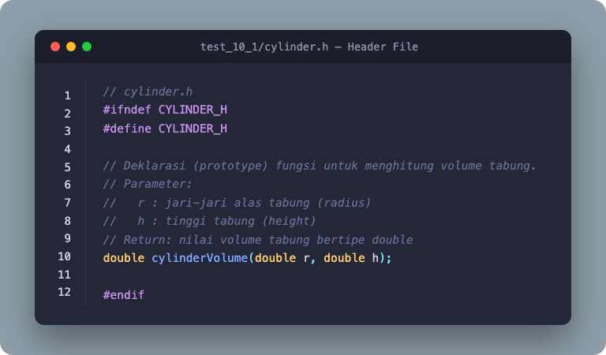
- **Source (`cylinder.cpp`):** 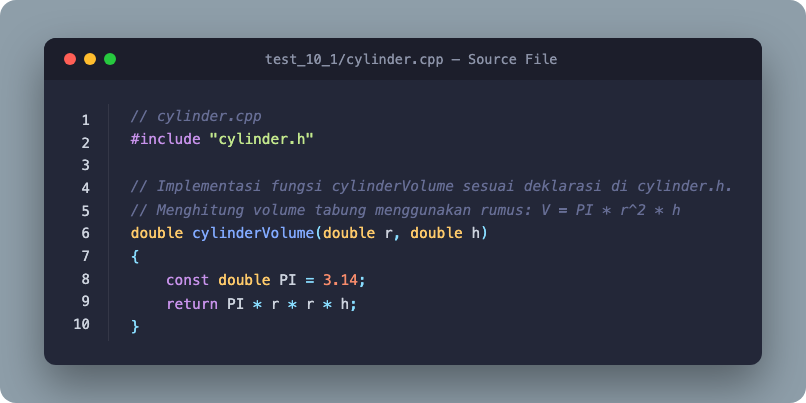
- **Main (`main.cpp`):** 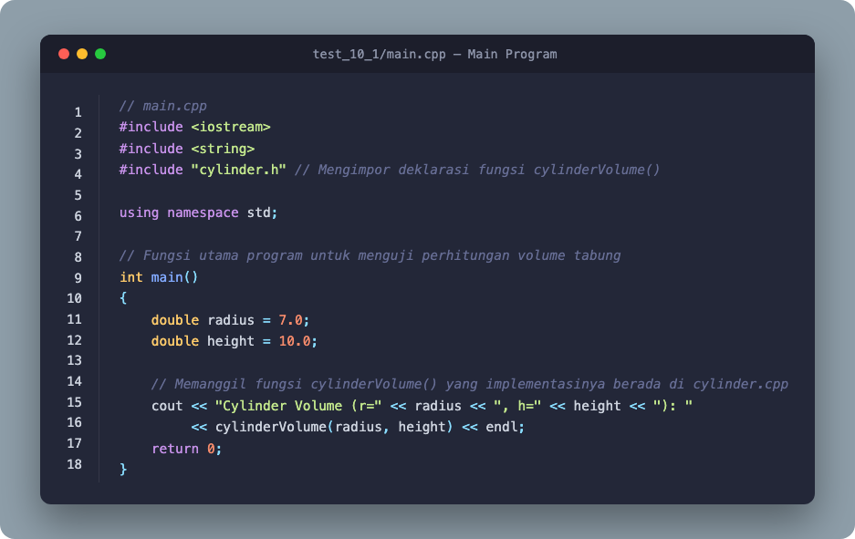
- **Compiled Output:** 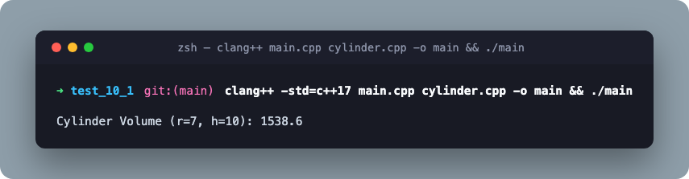

### Penjelasan Detail (10.1)
Proses bagaimana `main.cpp` dapat mengakses dan menjalankan fungsi `cylinderVolume` dari `cylinder.cpp` melalui `cylinder.h` terjadi dalam tiga tahap utama kompilasi C++:
1. **Preprocessing (`#include "cylinder.h"`):** Saat *preprocessor* memproses `main.cpp` (dan `cylinder.cpp`), baris `#include "cylinder.h"` digantikan secara langsung dengan isi dari file `cylinder.h`, yaitu *prototype* `double cylinderVolume(double r, double h);`. Dengan demikian, kompiler mengetahui nama fungsi, tipe kembalian (`double`), dan daftar parameternya (`double r, double h`) sebelum melihat definisi lengkapnya.
2. **Separate Compilation (Kompilasi Terpisah):** Kompiler mengompilasi `main.cpp` menjadi file objek (`main.o`) dan `cylinder.cpp` menjadi file objek (`cylinder.o`) secara terpisah. Di dalam `main.o`, pemanggilan `cylinderVolume(7, 10)` dicatat sebagai referensi simbol eksternal (*unresolved symbol*) karena implementasinya belum ada di `main.cpp`.
3. **Linking:** *Linker* menggabungkan `main.o` dan `cylinder.o` menjadi satu *executable* (`main`). Pada tahap ini, *linker* mencocokkan referensi simbol `cylinderVolume` dari `main.o` dengan definisi fungsi yang sebenarnya di dalam `cylinder.o`, sehingga program dapat dijalankan dan menghasilkan `Cylinder Volume: 1538.6`.

*(Catatan: Pada instruksi teks modul tertulis rumus $A = 2\pi r(h + r)$ yang merupakan luas permukaan tabung, sedangkan kode referensi pada modul mengimplementasikan volume tabung $V = \pi r^2 h$ sesuai nama fungsi `cylinderVolume`.)*

---

## 2. Test 10.2: Using Return and Void Functions in a Header File

### Instruksi
- Buat `square.h` berisi deklarasi `float squareArea(float s);` dan `void displayResult(float s);`.
- Buat `square.cpp` untuk mengimplementasikan kedua fungsi tersebut.
- Buat `main.cpp` yang meminta input panjang sisi $s$ dari pengguna, lalu memanggil `squareArea(s)` dan `displayResult(s)`.
- Jelaskan perbedaan antara fungsi dengan *return value* dan fungsi `void` dari segi penggunaannya.

### Code & Output Images
- **Header (`square.h`):** 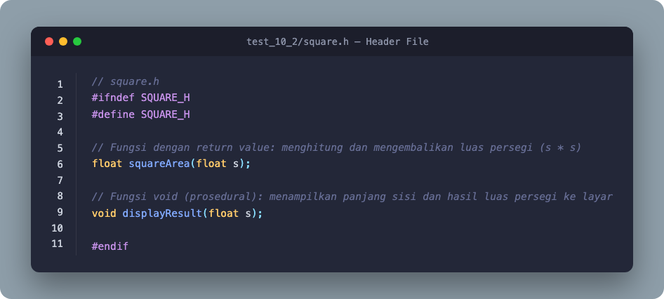
- **Source (`square.cpp`):** 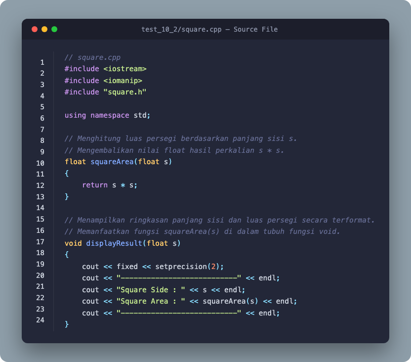
- **Main (`main.cpp`):** 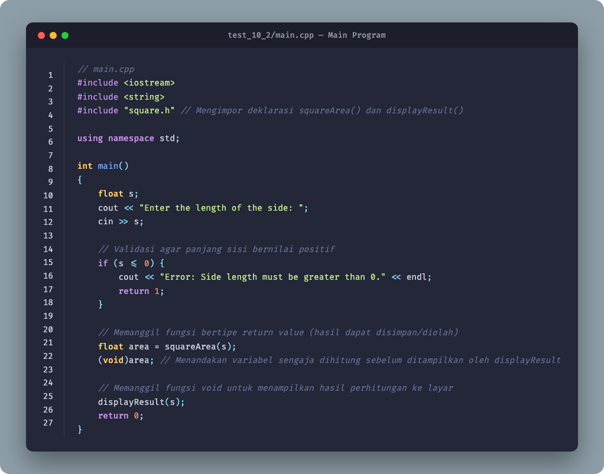
- **Compiled Output:** 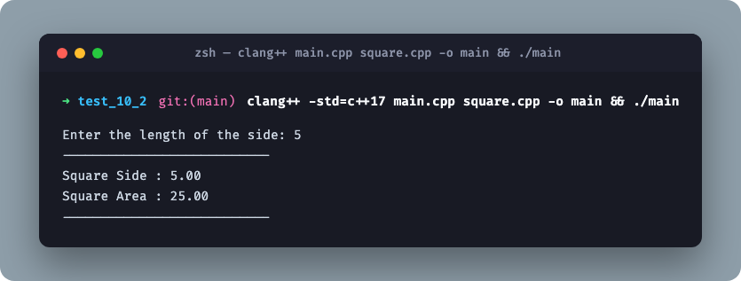

### Penjelasan Perbedaan Return Function vs Void Function (10.2)
| Aspek | Fungsi dengan *Return Value* (`float squareArea(float s)`) | Fungsi `void` (`void displayResult(float s)`) |
| :--- | :--- | :--- |
| **Nilai Kembalian** | Mengembalikan nilai bertipe spesifik (`float`) menggunakan kata kunci `return`. | Tidak mengembalikan nilai apa pun (`void`). |
| **Cara Pemanggilan** | Dapat digunakan di dalam ekspresi, disimpan ke variabel (`float a = squareArea(s);`), atau langsung dicetak (`cout << squareArea(s);`). | Dipanggil sebagai pernyataan (*statement*) berdiri sendiri (`displayResult(s);`), tidak dapat dimasukkan ke ekspresi atau `cout <<`. |
| **Tujuan Penggunaan** | Cocok untuk komputasi/perhitungan yang hasilnya dibutuhkan oleh bagian program lain (seperti `squareArea(s)` dipanggil di dalam `displayResult(s)`). | Cocok untuk menjalankan aksi atau prosedur seperti menampilkan output ke layar. |

---

## 3. Test 10.3: Creating a Complete Arithmetic Header

### Instruksi
- Buat `arithmetic.h` berisi deklarasi `addition`, `subtraction`, `multiplication`, dan `division`.
- Buat `arithmetic.cpp` berisi implementasi keempat fungsi tersebut.
- Buat `main.cpp` yang menggunakan seluruh fungsi untuk operasi pada dua bilangan (contoh: `10` dan `5`).
- Perbaiki kesalahan pada kode soal dan jelaskan apa yang salah.

### Code & Output Images
- **Header (`arithmetic.h`):** 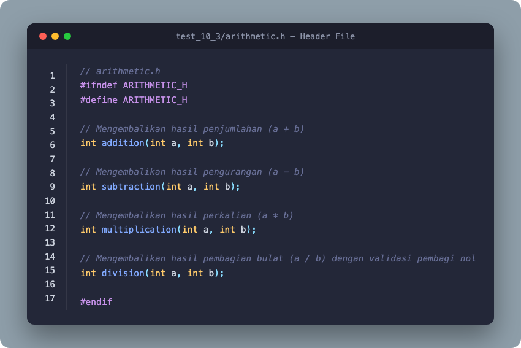
- **Source (`arithmetic.cpp`):** 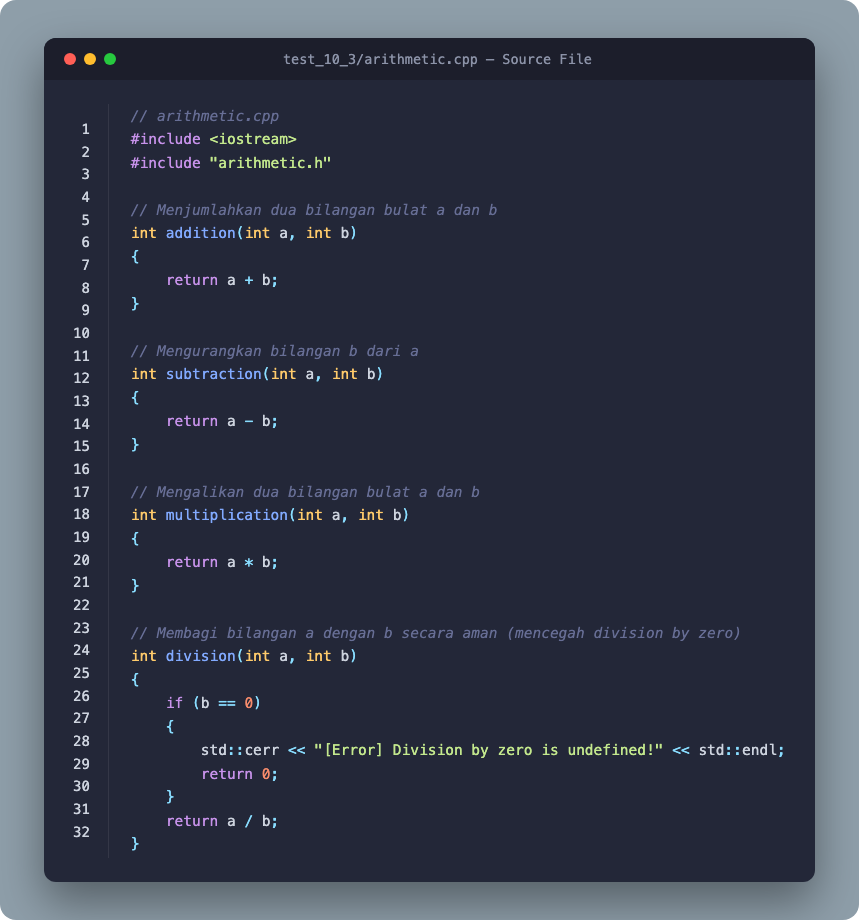
- **Main (`main.cpp` - Fixed):** 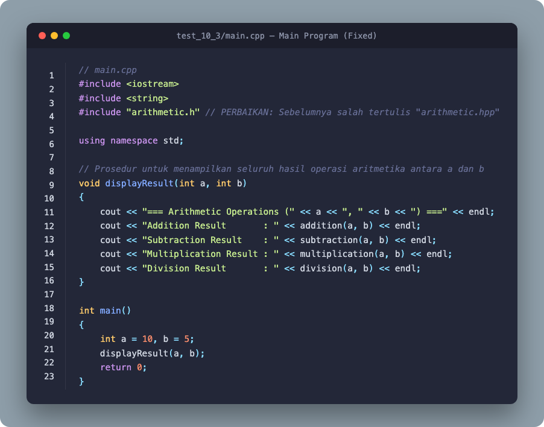
- **Compiled Output:** 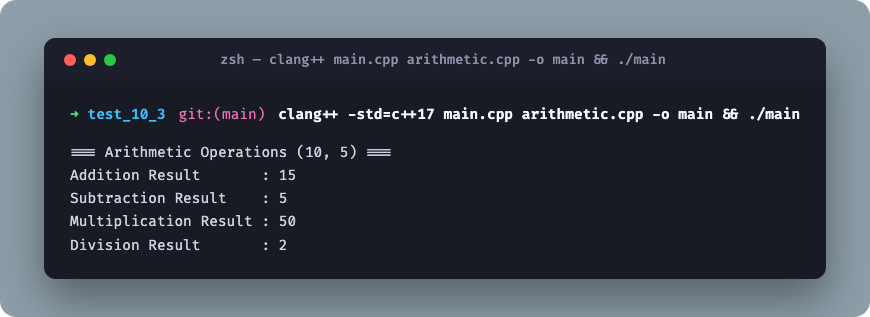

### Penjelasan Kesalahan & Perbaikan (10.3)
Pada potongan kode `main.cpp` di modul soal, baris ke-4 tertulis:
```cpp
#include "arithmetic.hpp"
```
**Kesalahan:** Ekstensi file header yang dibuat adalah `.h` (`arithmetic.h`), bukan `.hpp` (`arithmetic.hpp`). Akibatnya, saat dikompilasi akan muncul *error* `fatal error: 'arithmetic.hpp' file not found`.  
**Perbaikan:** Mengubah baris tersebut menjadi `#include "arithmetic.h"` agar sesuai dengan nama *header file* yang tersedia. Selain itu, pada `arithmetic.cpp` ditambahkan penjagaan pembagian dengan nol (`if (b == 0)`) agar program lebih aman.

---

## 4. Test 10.4: Temperature Conversion Header

### Instruksi
- Buat `conversion.h` dan `conversion.cpp` untuk fungsi konversi suhu: `celciusToFahrenheit`, `fahrenheitToCelcius`, `celciusToKelvin`, `kelvinToCelcius`.
- **Additional Challenge:** Modifikasi program agar dapat melakukan konversi antar skala suhu secara fleksibel, misalnya **Fahrenheit → Kelvin** (`fahrenheitToKelvin`) dan **Kelvin → Fahrenheit** (`kelvinToFahrenheit`).

### Code & Output Images
- **Header (`conversion.h`):** 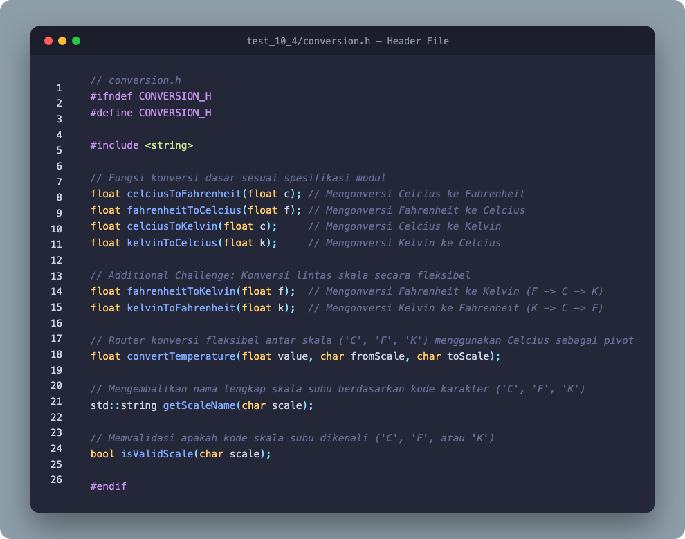
- **Source (`conversion.cpp`):** 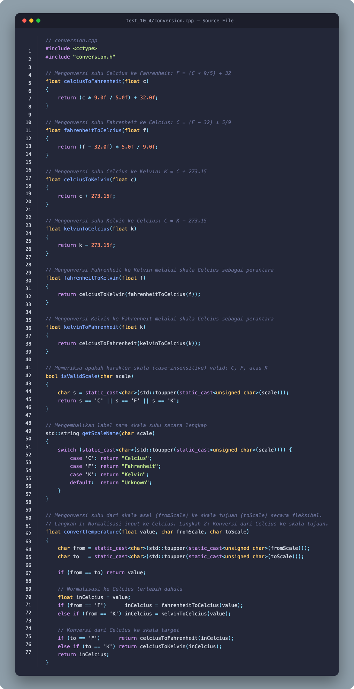
- **Main (`main.cpp`):** 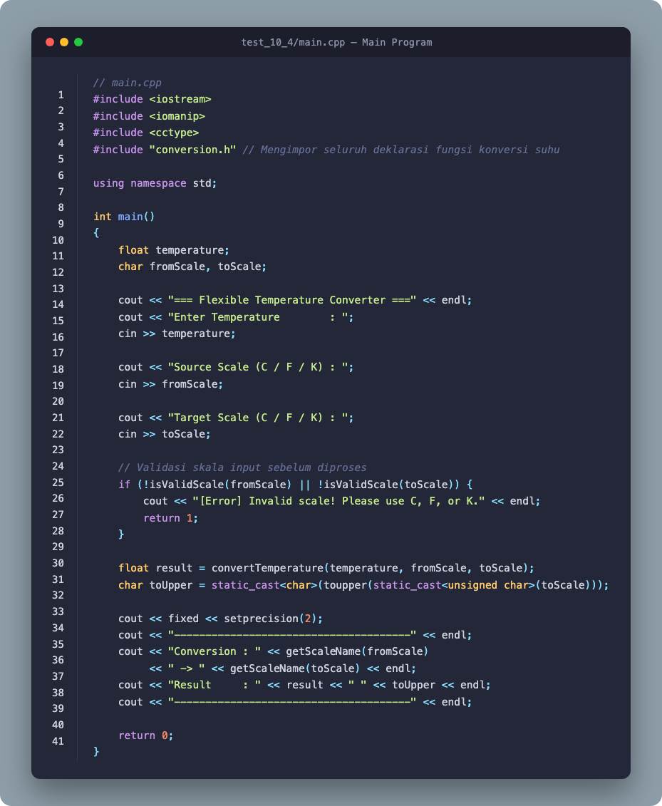
- **Compiled Output:** 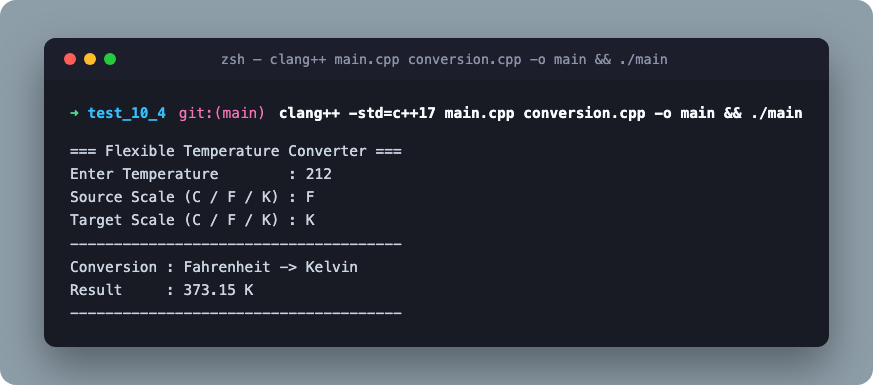

### Penjelasan (10.4)
- Selain mengimplementasikan empat fungsi dasar (`celciusToFahrenheit`, `fahrenheitToCelcius`, `celciusToKelvin`, `kelvinToCelcius`) dan memperbaiki *typo* penamaan `celciusTofahrenheit` pada contoh modul, program ditingkatkan agar mampu mengonversi antar skala secara fleksibel melalui:
  - `fahrenheitToKelvin(float f)` dan `kelvinToFahrenheit(float k)` yang memanfaatkan Celcius sebagai skala perantara.
  - `convertTemperature(float value, char fromScale, char toScale)` yang menormalisasi input dari skala asal (`C`, `F`, atau `K`, *case-insensitive*) ke Celcius lalu mengonversinya ke skala tujuan.
  - `isValidScale(char scale)` dan `getScaleName(char scale)` untuk validasi input serta format tampilan hasil yang rapi (`std::fixed`, `setprecision(2)`).

---

## 5. Test 10.5: Individual Task (2D Coordinate Distance Analysis)

### Instruksi
Buat aplikasi sederhana berdasarkan studi kasus pilihan sendiri yang menggabungkan:
- **Built-in functions** dari C++ (seperti `pow()`, `sqrt()`, `abs()` dari `<cmath>`).
- **User-defined functions** yang didefinisikan pada *header file* (`.h`) dan *source file* (`.cpp`) terpisah.

### Code & Output Images
- **Header (`geometry.h`):** 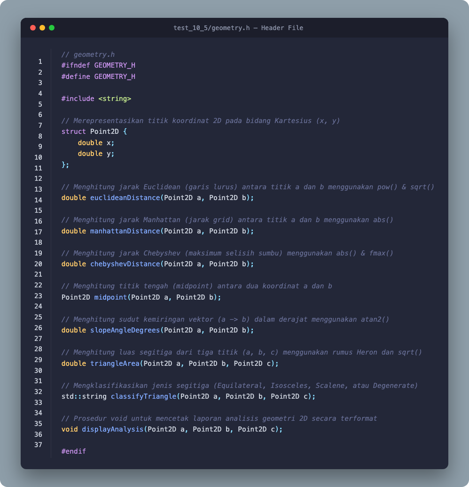
- **Source (`geometry.cpp`):** 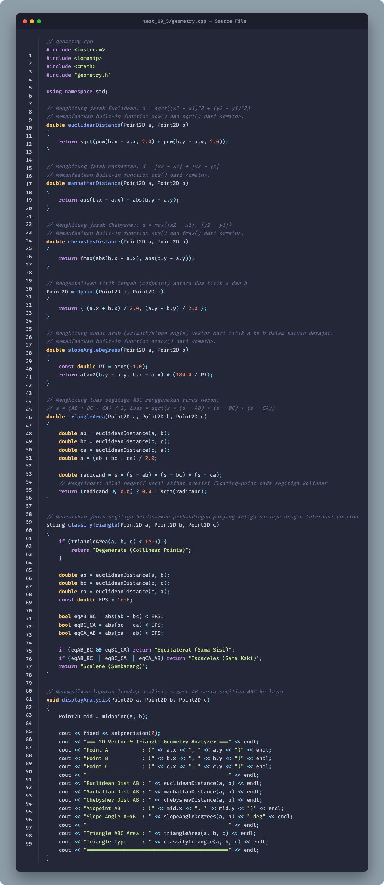
- **Main (`main.cpp`):** 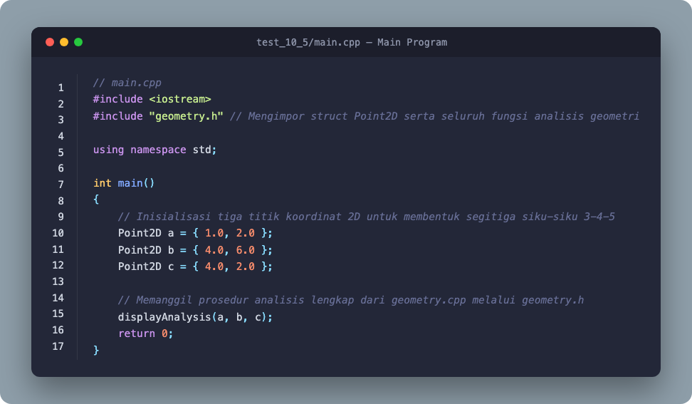
- **Compiled Output:** 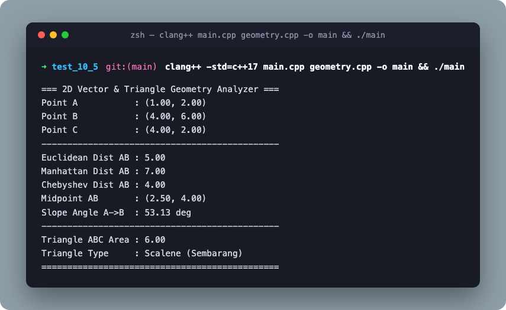

### Penjelasan Program (10.5)
Program ini mengimplementasikan **2D Vector & Triangle Geometry Analyzer** menggunakan `struct Point2D` untuk tiga titik koordinat $A(1, 2)$, $B(4, 6)$, dan $C(4, 2)$:
1. **User-Defined Functions (Modular di `geometry.h` & `geometry.cpp`):**
   - `euclideanDistance(a, b)`: menghitung jarak garis lurus $d = \sqrt{(x_2 - x_1)^2 + (y_2 - y_1)^2}$.
   - `manhattanDistance(a, b)`: menghitung jarak grid $|x_2 - x_1| + |y_2 - y_1|$.
   - `chebyshevDistance(a, b)`: menghitung jarak maksimum sumbu $\max(|x_2 - x_1|, |y_2 - y_1|)$.
   - `midpoint(a, b)`: mengembalikan titik tengah segmen $AB$.
   - `slopeAngleDegrees(a, b)`: menghitung sudut kemiringan vektor $A \to B$ dalam derajat.
   - `triangleArea(a, b, c)`: menghitung luas segitiga $ABC$ dengan rumus Heron.
   - `classifyTriangle(a, b, c)`: mengklasifikasikan jenis segitiga (*Equilateral*, *Isosceles*, *Scalene*, atau *Degenerate*) dengan toleransi *epsilon*.
   - `displayAnalysis(a, b, c)`: prosedur `void` untuk mencetak seluruh laporan analisis secara terformat.
2. **Built-in Functions (`<cmath>`):** Memanfaatkan `pow()`, `sqrt()`, `abs()`, `fmax()`, `atan2()`, dan `acos()` secara langsung di dalam fungsi-fungsi geometri.

---

## 📝 Conclusion of Today’s Lesson
Penggunaan *header files* (`.h`) dan *source files* (`.cpp`) terpisah memungkinkan pemisahan antara **deklarasi antarmuka** (*interface*) dan **implementasi logika** (*implementation*) dalam C++. Pendekatan modular ini membuat kode lebih terstruktur, mudah dibaca, mudah dipelihara (*maintainable*), serta memungkinkan fungsi-fungsi yang telah dibuat (seperti modul aritmetika, konversi suhu, maupun geometri) digunakan kembali (*reusable*) di berbagai program utama tanpa menulis ulang implementasinya.
