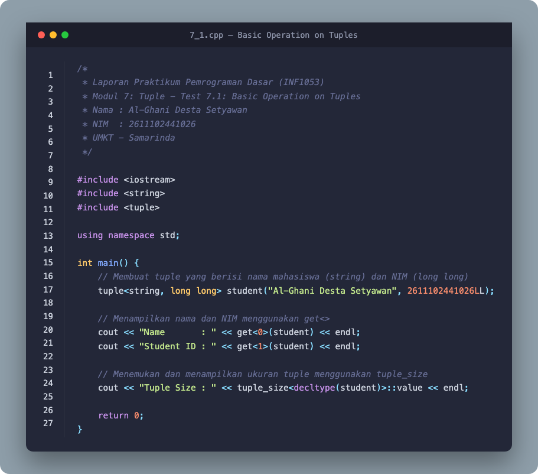
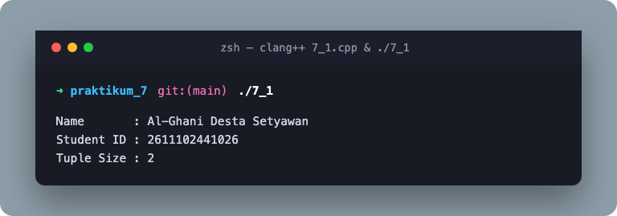
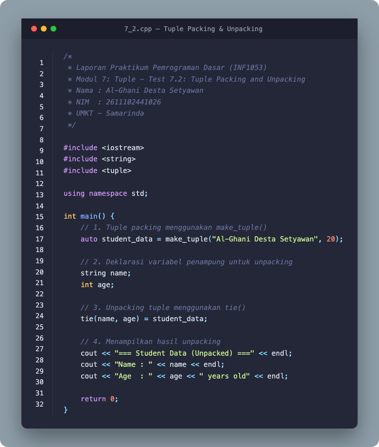
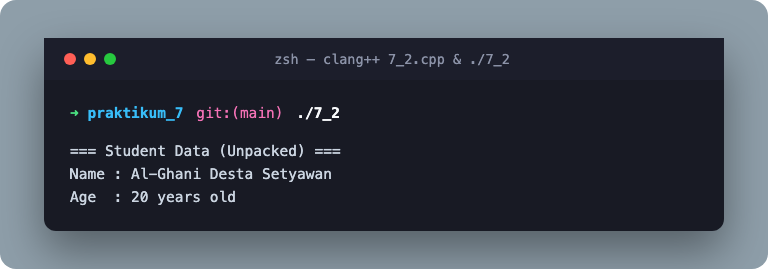
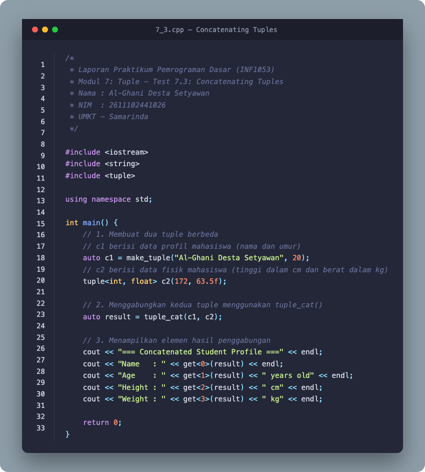
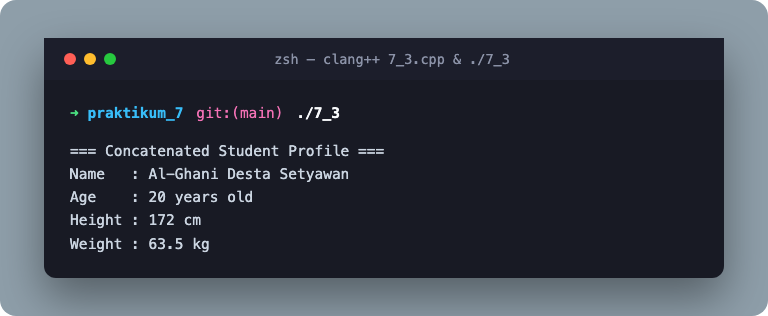
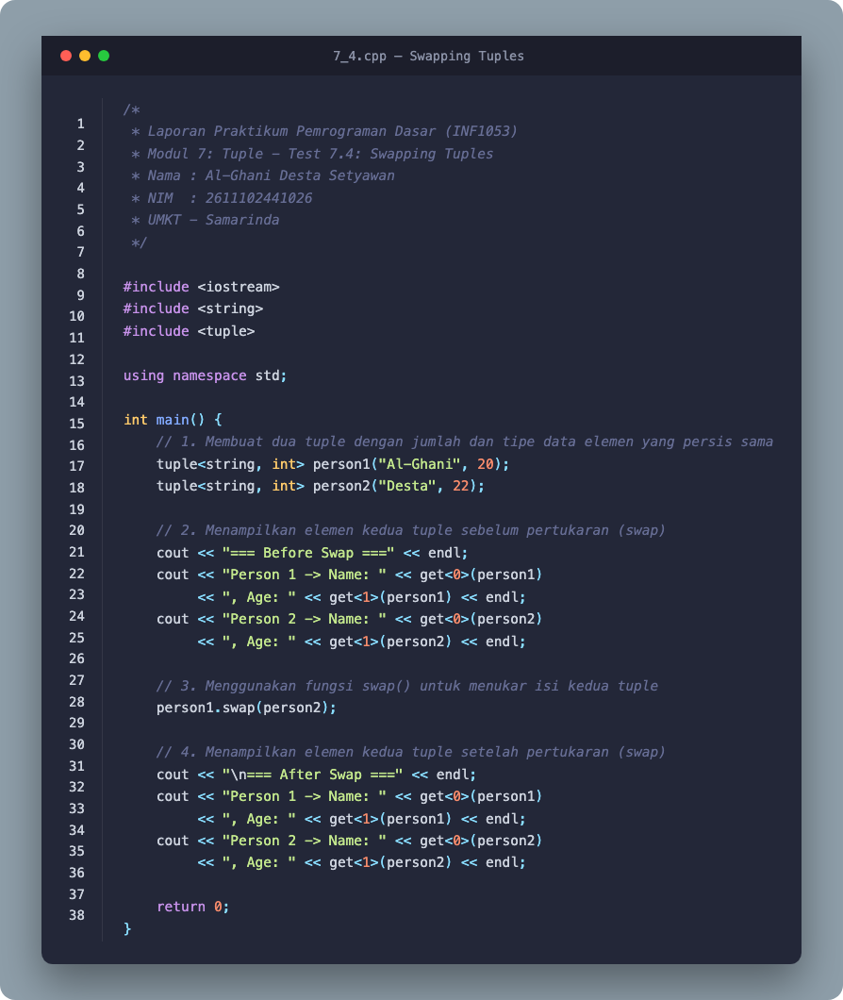
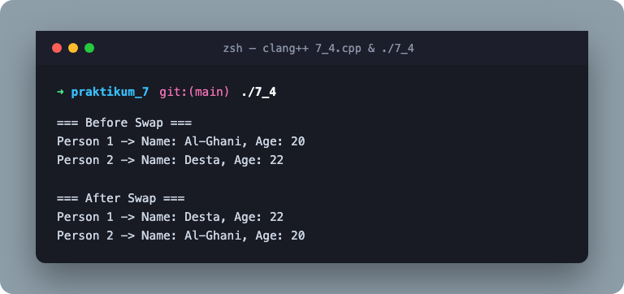

# LAPORAN PRAKTIKUM 7: TUPLE

**Basic Programming Practicum (INF1053)**  
**Program Studi:** Teknik Informatika  
**Fakultas:** Sains & Teknologi  
**Universitas:** Universitas Muhammadiyah Kalimantan Timur  
**Kota:** Samarinda, 2026  

- **Nama:** Al-Ghani Desta Setyawan
- **NIM:** 2611102441026

---

## 📌 Main Topic
**Tuple dalam C++ (`std::tuple`)**

## 🎯 Learning Objective
1. Memahami konsep struktur data heterogen berukuran tetap menggunakan `std::tuple`.
2. Mengimplementasikan operasi dasar tuple: inisialisasi, akses elemen dengan `std::get<>`, dan pemeriksaan ukuran dengan `std::tuple_size`.
3. Menguasai mekanisme *tuple packing* menggunakan `std::make_tuple()` dan *unpacking* menggunakan `std::tie()`.
4. Menggabungkan beberapa tuple berbeda tipe menggunakan `std::tuple_cat()`.
5. Melakukan pertukaran nilai antar tuple yang berukuran dan bertipe identik menggunakan fungsi `swap()`.

---

## 📂 Struktur Direktori Praktikum 7

```text
praktikum_7/
├── Practical Module 7 Tuple.docx   # Dokumen Laporan Praktikum Resmi (Telah terisi lengkap)
├── README.md                       # Dokumentasi Markdown Lengkap Praktikum 7
├── INIT_DOCS.md                    # Inisialisasi Ringkasan Eksekutif
├── 7_1.cpp                         # Source code Test 7.1: Basic Operation on Tuples
├── 7_2.cpp                         # Source code Test 7.2: Tuple Packing & Unpacking
├── 7_3.cpp                         # Source code Test 7.3: Concatenating Tuples
├── 7_4.cpp                         # Source code Test 7.4: Swapping Tuples
├── 7_1, 7_2, 7_3, 7_4              # Executable binaries (Compiled with clang++ / C++17)
├── render_images.py                # Script rendering visual code & terminal output
├── populate_docx.py                # Script otomasi pengisian dokumen Word (.docx)
└── assets/                         # Aset visual code & output hasil rendering
    ├── code_7_1.png
    ├── output_7_1.png
    ├── code_7_2.png
    ├── output_7_2.png
    ├── code_7_3.png
    ├── output_7_3.png
    ├── code_7_4.png
    └── output_7_4.png
```

---

## 🧪 Rincian Tugas & Implementasi

### 1. Test 7.1: Basic Operation on Tuples

#### Instruksi:
- Buat tuple yang berisi nama mahasiswa (`string`) dan NIM (`long long`).
- Tampilkan nama dan NIM menggunakan fungsi `get<>`.
- Temukan dan tampilkan ukuran tuple menggunakan `tuple_size<decltype()>::value`.

#### Source Code (`7_1.cpp`):
```cpp
/*
 * Laporan Praktikum Pemrograman Dasar (INF1053)
 * Modul 7: Tuple - Test 7.1: Basic Operation on Tuples
 * Nama : Al-Ghani Desta Setyawan
 * NIM  : 2611102441026
 * UMKT - Samarinda
 */

#include <iostream>
#include <string>
#include <tuple>

using namespace std;

int main() {
    // Membuat tuple yang berisi nama mahasiswa (string) dan NIM (long long)
    tuple<string, long long> student("Al-Ghani Desta Setyawan", 2611102441026LL);

    // Menampilkan nama dan NIM menggunakan get<>
    cout << "Name       : " << get<0>(student) << endl;
    cout << "Student ID : " << get<1>(student) << endl;

    // Menemukan dan menampilkan ukuran tuple menggunakan tuple_size
    cout << "Tuple Size : " << tuple_size<decltype(student)>::value << endl;

    return 0;
}
```

#### Visualisasi Code & Output:
| Code Image | Output Terminal Image |
| :---: | :---: |
|  |  |

#### Terminal Output:
```text
Name       : Al-Ghani Desta Setyawan
Student ID : 2611102441026
Tuple Size : 2
```

#### Penjelasan 7.1:
1. `tuple<string, long long> student(...)` mendefinisikan kontainer tuple 2-elemen dengan tipe data heterogen.
2. `get<0>(student)` mengambil nilai elemen pertama (nama), dan `get<1>(student)` mengambil elemen kedua (NIM). Indeks berbasis 0 dan wajib bertipe konstanta waktu kompilasi.
3. `tuple_size<decltype(student)>::value` mengevaluasi total elemen yang dikandung oleh tipe tuple pada waktu kompilasi, menghasilkan nilai `2`.

---

### 2. Test 7.2: Tuple Packing and Unpacking

#### Instruksi:
- Buat program yang menyimpan data mahasiswa (nama dan umur).
- Gunakan `make_tuple()` untuk proses *packing*.
- Gunakan `tie()` untuk proses *unpacking*.

#### Source Code (`7_2.cpp`):
```cpp
/*
 * Laporan Praktikum Pemrograman Dasar (INF1053)
 * Modul 7: Tuple - Test 7.2: Tuple Packing and Unpacking
 * Nama : Al-Ghani Desta Setyawan
 * NIM  : 2611102441026
 * UMKT - Samarinda
 */

#include <iostream>
#include <string>
#include <tuple>

using namespace std;

int main() {
    // 1. Tuple packing menggunakan make_tuple()
    auto student_data = make_tuple("Al-Ghani Desta Setyawan", 20);

    // 2. Deklarasi variabel penampung untuk unpacking
    string name;
    int age;

    // 3. Unpacking tuple menggunakan tie()
    tie(name, age) = student_data;

    // 4. Menampilkan hasil unpacking
    cout << "=== Student Data (Unpacked) ===" << endl;
    cout << "Name : " << name << endl;
    cout << "Age  : " << age << " years old" << endl;

    return 0;
}
```

#### Visualisasi Code & Output:
| Code Image | Output Terminal Image |
| :---: | :---: |
|  |  |

#### Terminal Output:
```text
=== Student Data (Unpacked) ===
Name : Al-Ghani Desta Setyawan
Age  : 20 years old
```

#### Penjelasan 7.2:
1. **Packing:** Fungsi pembantu `make_tuple()` mengemas elemen-elemen individual (`"Al-Ghani Desta Setyawan"`, `20`) ke dalam objek tuple terpadu tanpa mengharuskan programmer menuliskan parameter template tipe secara eksplisit.
2. **Unpacking:** Fungsi `tie(name, age)` membuat tuple lvalue reference yang memetakan elemen-elemen dari `student_data` langsung ke variabel lokal `name` dan `age`.

---

### 3. Test 7.3: Concatenating Tuples

#### Instruksi:
- Buat dua tuple yang berbeda.
- Gabungkan keduanya menggunakan `tuple_cat()`.
- Jelaskan kode dan keluarannya.

#### Source Code (`7_3.cpp`):
```cpp
/*
 * Laporan Praktikum Pemrograman Dasar (INF1053)
 * Modul 7: Tuple - Test 7.3: Concatenating Tuples
 * Nama : Al-Ghani Desta Setyawan
 * NIM  : 2611102441026
 * UMKT - Samarinda
 */

#include <iostream>
#include <string>
#include <tuple>

using namespace std;

int main() {
    // 1. Membuat dua tuple berbeda
    // c1 berisi data profil mahasiswa (nama dan umur)
    auto c1 = make_tuple("Al-Ghani Desta Setyawan", 20);
    // c2 berisi data fisik mahasiswa (tinggi badan dalam cm dan berat badan dalam kg)
    tuple<int, float> c2(172, 63.5f);

    // 2. Menggabungkan kedua tuple menggunakan tuple_cat()
    auto result = tuple_cat(c1, c2);

    // 3. Menampilkan elemen hasil penggabungan
    cout << "=== Concatenated Student Profile ===" << endl;
    cout << "Name   : " << get<0>(result) << endl;
    cout << "Age    : " << get<1>(result) << " years old" << endl;
    cout << "Height : " << get<2>(result) << " cm" << endl;
    cout << "Weight : " << get<3>(result) << " kg" << endl;

    return 0;
}
```

#### Visualisasi Code & Output:
| Code Image | Output Terminal Image |
| :---: | :---: |
|  |  |

#### Terminal Output:
```text
=== Concatenated Student Profile ===
Name   : Al-Ghani Desta Setyawan
Age    : 20 years old
Height : 172 cm
Weight : 63.5 kg
```

#### Penjelasan 7.3:
1. Tuple `c1` memiliki 2 elemen (`const char*`, `int`) dan `c2` memiliki 2 elemen (`int`, `float`).
2. `tuple_cat(c1, c2)` melakukan konkatenasi kedua tuple menjadi satu tuple baru `result` dengan tipe `tuple<const char*, int, int, float>` yang berisi 4 elemen.
3. Seluruh elemen dapat diakses secara terindeks berurutan mulai dari `get<0>` hingga `get<3>`.

---

### 4. Test 7.4: Swapping Tuples

#### Instruksi:
- Buat dua tuple dengan jumlah dan tipe data elemen yang sama.
- Tampilkan elemen kedua tuple sebelum pertukaran.
- Gunakan fungsi `swap()` untuk menukar nilai kedua tuple.
- Tampilkan elemen setelah pertukaran, dan jelaskan cara kerja fungsi `swap()` pada tuple.

#### Source Code (`7_4.cpp`):
```cpp
/*
 * Laporan Praktikum Pemrograman Dasar (INF1053)
 * Modul 7: Tuple - Test 7.4: Swapping Tuples
 * Nama : Al-Ghani Desta Setyawan
 * NIM  : 2611102441026
 * UMKT - Samarinda
 */

#include <iostream>
#include <string>
#include <tuple>

using namespace std;

int main() {
    // 1. Membuat dua tuple dengan jumlah dan tipe data elemen yang persis sama
    tuple<string, int> person1("Al-Ghani", 20);
    tuple<string, int> person2("Desta", 22);

    // 2. Menampilkan elemen kedua tuple sebelum pertukaran (swap)
    cout << "=== Before Swap ===" << endl;
    cout << "Person 1 -> Name: " << get<0>(person1)
         << ", Age: " << get<1>(person1) << endl;
    cout << "Person 2 -> Name: " << get<0>(person2)
         << ", Age: " << get<1>(person2) << endl;

    // 3. Menggunakan fungsi swap() untuk menukar isi kedua tuple
    person1.swap(person2);

    // 4. Menampilkan elemen kedua tuple setelah pertukaran (swap)
    cout << "\n=== After Swap ===" << endl;
    cout << "Person 1 -> Name: " << get<0>(person1)
         << ", Age: " << get<1>(person1) << endl;
    cout << "Person 2 -> Name: " << get<0>(person2)
         << ", Age: " << get<1>(person2) << endl;

    return 0;
}
```

#### Visualisasi Code & Output:
| Code Image | Output Terminal Image |
| :---: | :---: |
|  |  |

#### Terminal Output:
```text
=== Before Swap ===
Person 1 -> Name: Al-Ghani, Age: 20
Person 2 -> Name: Desta, Age: 22

=== After Swap ===
Person 1 -> Name: Desta, Age: 22
Person 2 -> Name: Al-Ghani, Age: 20
```

#### Penjelasan 7.4:
1. **Element-wise Swap:** `person1.swap(person2)` menukar isi elemen-elemen tuple secara berpasangan pada setiap indeks yang bersesuaian melalui pemanggilan internal `std::swap(get<i>(person1), get<i>(person2))`.
2. **Kesesuaian Tipe:** Kedua objek tuple wajib memiliki tipe data dan jumlah elemen yang identik. Apabila terdapat ketidakcocokan tipe atau ukuran, proses kompilasi akan digagalkan oleh compiler.
3. **Efisiensi:** Pertukaran dilakukan menggunakan semantik pemindahan (*move semantics*), sehingga sangat cepat dan tidak memakan overhead memori tambahan.

---

## 🎓 Kesimpulan Pembelajaran (Conclusion)

1. **Struktur Data Heterogen:** `std::tuple` (header `<tuple>`) memperluas kapabilitas `std::pair` dengan mengizinkan penyimpanan sejumlah berapapun elemen bernilai heterogen (tipe data berbeda) dalam satu entitas kontainer yang aman secara tipe (*type-safe*).
2. **Inspeksi & Akses Statis:** Nilai elemen diakses melalui `std::get<index>()` dan ukurannya dapat divalidasi pada saat kompilasi (*compile-time*) menggunakan `std::tuple_size<decltype(tuple)>::value`.
3. **Kemudahan Manipulasi Data:** 
   - `std::make_tuple()` memberikan kemudahan *packing* otomatis.
   - `std::tie()` dan `std::ignore` mempermudah *unpacking* ke variabel individu.
   - `std::tuple_cat()` memungkinkan penggabungan multi-tuple secara fleksibel.
   - `swap()` memberikan operasi pertukaran isi berkecepatan tinggi antar tuple bertipe sepadan.
4. **Relevansi Industri & Standar Modern:** Tuple merupakan fondasi krusial dalam C++ modern untuk mengembalikan banyak nilai dari fungsi (*multiple return values*), pemrograman generik/metaprogramming template, serta bersinergi dengan fitur *Structured Binding* (`auto [a, b] = my_tuple`) pada standar C++17 ke atas.
