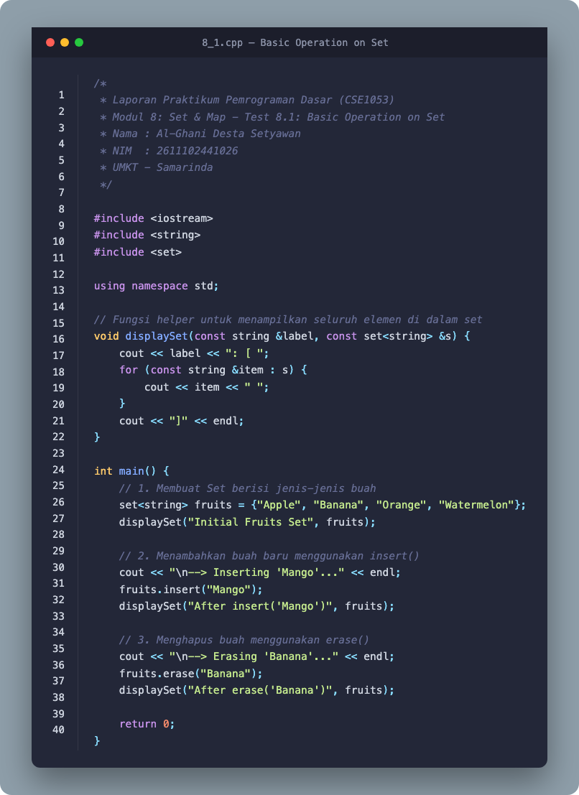
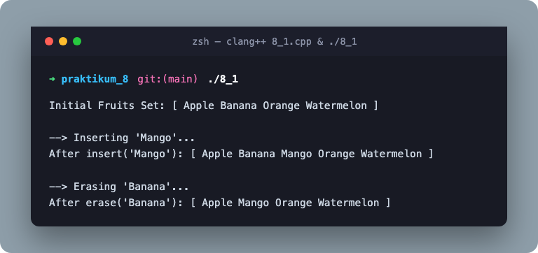
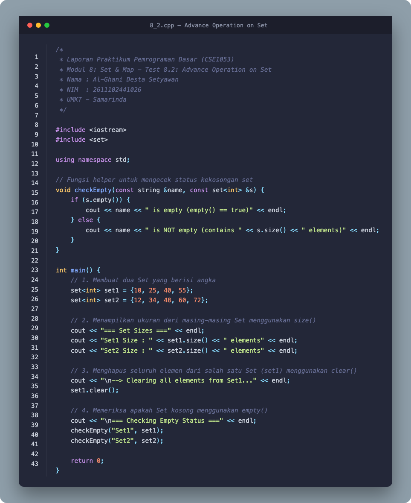
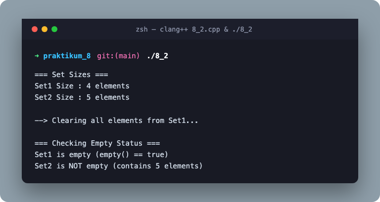
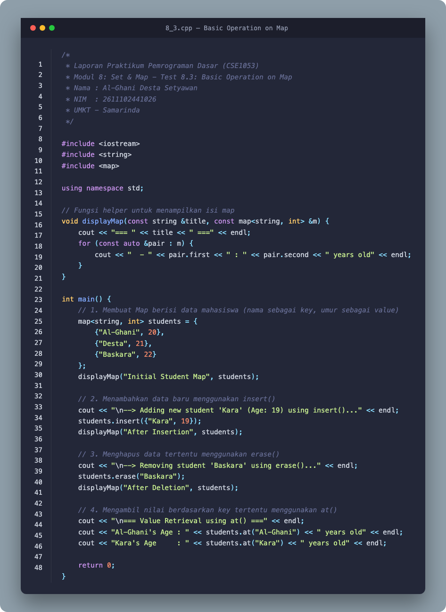
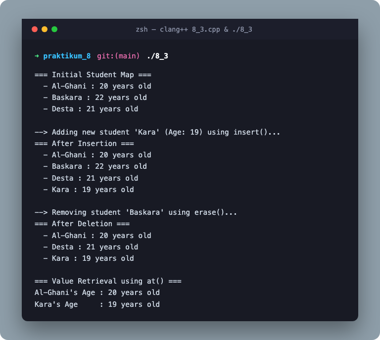
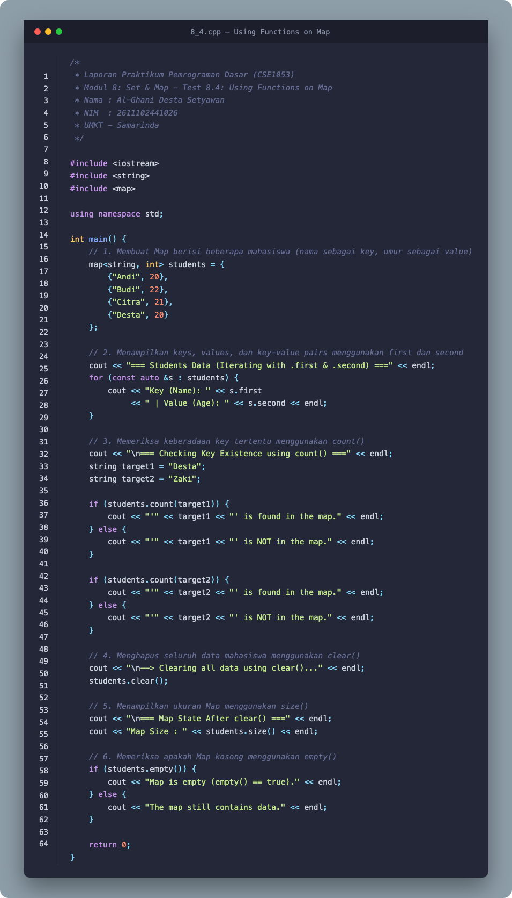
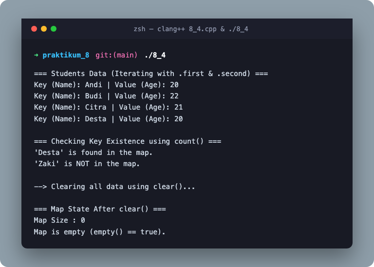

# LAPORAN PRAKTIKUM 8: SET & MAP

**Basic Programming Practicum (CSE1053)**  
**Program Studi:** Teknik Informatika (Computer Science)  
**Fakultas:** Sains & Teknologi (Science & Technology Faculty)  
**Universitas:** Universitas Muhammadiyah Kalimantan Timur  
**Kota:** Samarinda, 2026  

- **Nama:** Al-Ghani Desta Setyawan
- **NIM:** 2611102441026

---

## 📌 Main Topic
**Set & Map dalam C++ (`std::set` & `std::map`)**

## 🎯 Learning Objective
1. Mengimplementasikan dan memahami konsep struktur data asosiatif unik terurut menggunakan `std::set`.
2. Menguasai operasi dasar pada set: inisialisasi, penyisipan elemen dengan `insert()`, penghapusan dengan `erase()`, pemeriksaan ukuran dengan `size()`, pengosongan dengan `clear()`, dan validasi status kekosongan dengan `empty()`.
3. Mengimplementasikan struktur data pemetaan pasangan kunci-nilai (*key-value pair*) menggunakan `std::map`.
4. Menguasai operasi dasar pada map: iterasi pasangan data menggunakan `.first` dan `.second`, pengecekan keberadaan kunci dengan `count()`, dan pengambilan nilai yang aman dengan `at()`.

---

## 📂 Struktur Direktori Praktikum 8

```text
praktikum_8/
├── Practical Module 8 Set and Map.pdf   # File Modul Praktikum 8 Asli
├── Practical Module 8 Set and Map.docx  # Dokumen Laporan Praktikum Resmi (Telah terisi lengkap)
├── README.md                            # Dokumentasi Markdown Lengkap Praktikum 8
├── INIT_DOCS.md                         # Inisialisasi Ringkasan Eksekutif & Run Guide
├── 8_1.cpp                              # Source code Test 8.1: Basic Operation on Set
├── 8_2.cpp                              # Source code Test 8.2: Advance Operation on Set
├── 8_3.cpp                              # Source code Test 8.3: Basic Operation on Map
├── 8_4.cpp                              # Source code Test 8.4: Using Functions on Map
├── 8_1, 8_2, 8_3, 8_4                   # Executable binaries (Compiled with clang++ / C++17)
├── render_images.py                     # Script rendering visual code & terminal output
├── build_module_8_docx.py               # Script otomasi pembuatan laporan dokumen Word
└── assets/                              # Aset visual code & output hasil rendering
    ├── code_8_1.png
    ├── output_8_1.png
    ├── code_8_2.png
    ├── output_8_2.png
    ├── code_8_3.png
    ├── output_8_3.png
    ├── code_8_4.png
    └── output_8_4.png
```

---

## 🧪 Rincian Tugas & Implementasi

### 1. Test 8.1: Basic Operation on Set

#### Instruksi:
1. Buat sebuah Set berisi jenis-jenis buah.
2. Tambahkan buah baru menggunakan `insert()`.
3. Hapus sebuah buah menggunakan `erase()`.
4. Tampilkan isi Set setelah setiap operasi.

#### Source Code (`8_1.cpp`):
```cpp
/*
 * Laporan Praktikum Pemrograman Dasar (CSE1053)
 * Modul 8: Set & Map - Test 8.1: Basic Operation on Set
 * Nama : Al-Ghani Desta Setyawan
 * NIM  : 2611102441026
 * UMKT - Samarinda
 */

#include <iostream>
#include <string>
#include <set>

using namespace std;

// Fungsi helper untuk menampilkan seluruh elemen di dalam set
void displaySet(const string &label, const set<string> &s) {
    cout << label << ": [ ";
    for (const string &item : s) {
        cout << item << " ";
    }
    cout << "]" << endl;
}

int main() {
    // 1. Membuat Set berisi jenis-jenis buah
    set<string> fruits = {"Apple", "Banana", "Orange", "Watermelon"};
    displaySet("Initial Fruits Set", fruits);

    // 2. Menambahkan buah baru menggunakan insert()
    cout << "\n--> Inserting 'Mango'..." << endl;
    fruits.insert("Mango");
    displaySet("After insert('Mango')", fruits);

    // 3. Menghapus buah menggunakan erase()
    cout << "\n--> Erasing 'Banana'..." << endl;
    fruits.erase("Banana");
    displaySet("After erase('Banana')", fruits);

    return 0;
}
```

#### Visualisasi Code & Output:
| Code Image | Output Terminal Image |
| :---: | :---: |
|  |  |

#### Terminal Output:
```text
Initial Fruits Set: [ Apple Banana Orange Watermelon ]

--> Inserting 'Mango'...
After insert('Mango'): [ Apple Banana Mango Orange Watermelon ]

--> Erasing 'Banana'...
After erase('Banana'): [ Apple Mango Orange Watermelon ]
```

#### Penjelasan 8.1:
1. `std::set<string>` secara otomatis mengurutkan elemennya secara *ascending* (alfabetis) dan mencegah adanya elemen duplikat.
2. Ketika `"Mango"` disisipkan melalui `fruits.insert("Mango")`, set menempatkannya di antara `"Banana"` dan `"Orange"` secara otomatis sesuai urutan leksikografis.
3. Fungsi `fruits.erase("Banana")` mencari dan menghapus nilai `"Banana"` dengan efisiensi waktu logaritmik $\mathcal{O}(\log N)$.

---

### 2. Test 8.2: Advance Operation on Set

#### Instruksi:
1. Buat dua Set yang berisi kumpulan angka.
2. Tampilkan ukuran dari masing-masing Set.
3. Hapus seluruh elemen dari salah satu Set menggunakan `clear()`.
4. Periksa apakah Set kosong menggunakan fungsi `empty()`.

#### Source Code (`8_2.cpp`):
```cpp
/*
 * Laporan Praktikum Pemrograman Dasar (CSE1053)
 * Modul 8: Set & Map - Test 8.2: Advance Operation on Set
 * Nama : Al-Ghani Desta Setyawan
 * NIM  : 2611102441026
 * UMKT - Samarinda
 */

#include <iostream>
#include <set>

using namespace std;

// Fungsi helper untuk mengecek status kekosongan set
void checkEmpty(const string &name, const set<int> &s) {
    if (s.empty()) {
        cout << name << " is empty (empty() == true)" << endl;
    } else {
        cout << name << " is NOT empty (contains " << s.size() << " elements)" << endl;
    }
}

int main() {
    // 1. Membuat dua Set yang berisi angka
    set<int> set1 = {10, 25, 40, 55};
    set<int> set2 = {12, 34, 48, 60, 72};

    // 2. Menampilkan ukuran dari masing-masing Set menggunakan size()
    cout << "=== Set Sizes ===" << endl;
    cout << "Set1 Size : " << set1.size() << " elements" << endl;
    cout << "Set2 Size : " << set2.size() << " elements" << endl;

    // 3. Menghapus seluruh elemen dari salah satu Set (set1) menggunakan clear()
    cout << "\n--> Clearing all elements from Set1..." << endl;
    set1.clear();

    // 4. Memeriksa apakah Set kosong menggunakan empty()
    cout << "\n=== Checking Empty Status ===" << endl;
    checkEmpty("Set1", set1);
    checkEmpty("Set2", set2);

    return 0;
}
```

#### Visualisasi Code & Output:
| Code Image | Output Terminal Image |
| :---: | :---: |
|  |  |

#### Terminal Output:
```text
=== Set Sizes ===
Set1 Size : 4 elements
Set2 Size : 5 elements

--> Clearing all elements from Set1...

=== Checking Empty Status ===
Set1 is empty (empty() == true)
Set2 is NOT empty (contains 5 elements)
```

#### Penjelasan 8.2:
1. `set1.size()` dan `set2.size()` mengembalikan jumlah elemen aktif yang ada di dalam masing-masing set secara dinamis.
2. `set1.clear()` mengosongkan kontainer secara total dan membebaskan memori yang digunakan oleh elemen-elemennya.
3. `s.empty()` mengembalikan `true` jika kontainer tidak memiliki elemen (`size() == 0`), dan `false` jika masih berisi setidaknya satu elemen.

---

### 3. Test 8.3: Basic Operation on Map

#### Instruksi:
1. Buat sebuah Map yang menyimpan data mahasiswa (nama sebagai *key*, umur sebagai *value*).
2. Tambahkan data baru menggunakan `insert()`.
3. Hapus data tertentu menggunakan `erase()`.
4. Ambil dan tampilkan nilai berdasarkan *key* tertentu menggunakan `at()`.

#### Source Code (`8_3.cpp`):
```cpp
/*
 * Laporan Praktikum Pemrograman Dasar (CSE1053)
 * Modul 8: Set & Map - Test 8.3: Basic Operation on Map
 * Nama : Al-Ghani Desta Setyawan
 * NIM  : 2611102441026
 * UMKT - Samarinda
 */

#include <iostream>
#include <string>
#include <map>

using namespace std;

// Fungsi helper untuk menampilkan isi map
void displayMap(const string &title, const map<string, int> &m) {
    cout << "=== " << title << " ===" << endl;
    for (const auto &pair : m) {
        cout << "  - " << pair.first << " : " << pair.second << " years old" << endl;
    }
}

int main() {
    // 1. Membuat Map berisi data mahasiswa (nama sebagai key, umur sebagai value)
    map<string, int> students = {
        {"Al-Ghani", 20},
        {"Desta", 21},
        {"Baskara", 22}
    };
    displayMap("Initial Student Map", students);

    // 2. Menambahkan data baru menggunakan insert()
    cout << "\n--> Adding new student 'Kara' (Age: 19) using insert()..." << endl;
    students.insert({"Kara", 19});
    displayMap("After Insertion", students);

    // 3. Menghapus data tertentu menggunakan erase()
    cout << "\n--> Removing student 'Baskara' using erase()..." << endl;
    students.erase("Baskara");
    displayMap("After Deletion", students);

    // 4. Mengambil nilai berdasarkan key tertentu menggunakan at()
    cout << "\n=== Value Retrieval using at() ===" << endl;
    cout << "Al-Ghani's Age : " << students.at("Al-Ghani") << " years old" << endl;
    cout << "Kara's Age     : " << students.at("Kara") << " years old" << endl;

    return 0;
}
```

#### Visualisasi Code & Output:
| Code Image | Output Terminal Image |
| :---: | :---: |
|  |  |

#### Terminal Output:
```text
=== Initial Student Map ===
  - Al-Ghani : 20 years old
  - Baskara : 22 years old
  - Desta : 21 years old

--> Adding new student 'Kara' (Age: 19) using insert()...
=== After Insertion ===
  - Al-Ghani : 20 years old
  - Baskara : 22 years old
  - Desta : 21 years old
  - Kara : 19 years old

--> Removing student 'Baskara' using erase()...
=== After Deletion ===
  - Al-Ghani : 20 years old
  - Desta : 21 years old
  - Kara : 19 years old

=== Value Retrieval using at() ===
Al-Ghani's Age : 20 years old
Kara's Age     : 19 years old
```

#### Penjelasan 8.3:
1. `std::map<string, int>` mengaitkan setiap nama mahasiswa (*key*, unik & terurut) dengan nilai umurnya (*value*).
2. `students.insert({"Kara", 19})` menambahkan pasangan baru secara efisien.
3. `students.erase("Baskara")` mencari kunci `"Baskara"` dan menghapus simpul pasangan tersebut dari pohon biner pencarian red-black map.
4. `students.at("Al-Ghani")` mengambil nilai umur yang diasosiasikan dengan kunci tersebut. Berbeda dengan operator `[]`, metode `at()` melakukan pengecekan batas dan akan melempar `std::out_of_range` jika kunci tidak ditemukan.

---

### 4. Test 8.4: Using Functions on Map

#### Instruksi:
1. Buat sebuah Map berisi beberapa mahasiswa beserta umurnya.
2. Tampilkan semua kunci, nilai, dan pasangan kunci-nilai menggunakan `first` dan `second`.
3. Periksa keberadaan kunci tertentu menggunakan `count()`.
4. Hapus semua data mahasiswa menggunakan `clear()`.
5. Tampilkan ukuran Map menggunakan `size()`.
6. Periksa apakah Map kosong menggunakan `empty()`.

#### Source Code (`8_4.cpp`):
```cpp
/*
 * Laporan Praktikum Pemrograman Dasar (CSE1053)
 * Modul 8: Set & Map - Test 8.4: Using Functions on Map
 * Nama : Al-Ghani Desta Setyawan
 * NIM  : 2611102441026
 * UMKT - Samarinda
 */

#include <iostream>
#include <string>
#include <map>

using namespace std;

int main() {
    // 1. Membuat Map berisi beberapa mahasiswa (nama sebagai key, umur sebagai value)
    map<string, int> students = {
        {"Andi", 20},
        {"Budi", 22},
        {"Citra", 21},
        {"Desta", 20}
    };

    // 2. Menampilkan keys, values, dan key-value pairs menggunakan first dan second
    cout << "=== Students Data (Iterating with .first & .second) ===" << endl;
    for (const auto &s : students) {
        cout << "Key (Name): " << s.first 
             << " | Value (Age): " << s.second << endl;
    }

    // 3. Memeriksa keberadaan key tertentu menggunakan count()
    cout << "\n=== Checking Key Existence using count() ===" << endl;
    string target1 = "Desta";
    string target2 = "Zaki";

    if (students.count(target1)) {
        cout << "'" << target1 << "' is found in the map." << endl;
    } else {
        cout << "'" << target1 << "' is NOT in the map." << endl;
    }

    if (students.count(target2)) {
        cout << "'" << target2 << "' is found in the map." << endl;
    } else {
        cout << "'" << target2 << "' is NOT in the map." << endl;
    }

    // 4. Menghapus seluruh data mahasiswa menggunakan clear()
    cout << "\n--> Clearing all data using clear()..." << endl;
    students.clear();

    // 5. Menampilkan ukuran Map menggunakan size()
    cout << "\n=== Map State After clear() ===" << endl;
    cout << "Map Size : " << students.size() << endl;

    // 6. Memeriksa apakah Map kosong menggunakan empty()
    if (students.empty()) {
        cout << "Map is empty (empty() == true)." << endl;
    } else {
        cout << "The map still contains data." << endl;
    }

    return 0;
}
```

#### Visualisasi Code & Output:
| Code Image | Output Terminal Image |
| :---: | :---: |
|  |  |

#### Terminal Output:
```text
=== Students Data (Iterating with .first & .second) ===
Key (Name): Andi | Value (Age): 20
Key (Name): Budi | Value (Age): 22
Key (Name): Citra | Value (Age): 21
Key (Name): Desta | Value (Age): 20

=== Checking Key Existence using count() ===
'Desta' is found in the map.
'Zaki' is NOT in the map.

--> Clearing all data using clear()...

=== Map State After clear() ===
Map Size : 0
Map is empty (empty() == true).
```

#### Penjelasan 8.4:
1. Elemen map disimpan dalam bentuk pasangan `std::pair<const Key, Value>`, di mana `.first` adalah kunci dan `.second` adalah nilainya.
2. `students.count(target)` mengembalikan nilai `1` jika kunci ada di dalam map, dan `0` jika tidak ada, menjadikannya cara paling idiomatis untuk memeriksa eksistensi kunci tanpa membuat entri kosong baru secara tidak sengaja.
3. Fungsi `clear()` membersihkan seluruh elemen, divalidasi oleh `size() == 0` dan `empty() == true`.

---

## 🎓 Conclusion of Today's Lesson

> **Dari praktikum modul 8 hari ini tentang Set & Map di C++, hal-hal utama yang saya pelajari dan pahami adalah:**
>
> 1. **Karakteristik `std::set`:** Set adalah kontainer asosiatif yang hanya menyimpan nilai-nilai unik dan secara otomatis mengurutkannya dari yang terkecil ke terbesar. Saya belajar menambahkan data menggunakan `insert()`, menghapus data tertentu menggunakan `erase()`, memeriksa jumlah elemen dengan `size()`, serta mengosongkannya dengan `clear()` dan memvalidasinya lewat `empty()`.
> 2. **Karakteristik `std::map`:** Map menyimpan pasangan data berupa *key-value* (`std::pair`), di mana kuncinya (*key*) selalu unik dan terurut. Saya belajar mengakses kunci melalui `.first` dan nilainya melalui `.second`.
> 3. **Operasi & Fungsi Kunci Map:** Saya memahami cara mengambil nilai dengan aman menggunakan `at()` (karena memiliki *bounds checking*), memvalidasi keberadaan suatu kunci menggunakan fungsi `count()`, serta mengosongkan seluruh pasangan data menggunakan `clear()`.
>
> **Kesimpulannya**, `std::set` dan `std::map` sangat mempermudah saya dalam mengelola data yang membutuhkan pencarian cepat $\mathcal{O}(\log N)$, jaminan keunikan data, serta asosiasi relasi antar-data tanpa perlu menulis algoritma pengurutan dan pencarian secara manual.
