# LAPORAN PRAKTIKUM 9: FUNCTIONS & LAMBDA

**Basic Programming Practicum (INF1053)**  
**Program Studi:** S1 Teknik Informatika  
**Fakultas:** Sains & Teknologi  
**Universitas:** Universitas Muhammadiyah Kalimantan Timur  
**Kota:** Samarinda, 2026  

- **Nama:** Al-Ghani Desta Setyawan
- **NIM:** 2611102441026

---

## 📌 Main Topic
**Functions & Lambda dalam C++**
1. Standard Functions (Value-returning & Void)
2. Default Argument Parameters
3. Function Prototypes (Forward Declaration)
4. Lambda Expressions (Syntax, Invocation, Capture Clause vs. Parameters)
5. Recursion (Simulasi Looping Tanpa Loop Statement)

## 🎯 Learning Objective
1. Mengimplementasikan fungsi dengan nilai kembalian (*return value*) dan fungsi prosedural (*void*).
2. Memahami dan menerapkan nilai bawaan (*default value parameter*) pada fungsi.
3. Menguasai pemisahan antara deklarasi fungsi (*prototype*) dan definisi fungsi (*implementation*).
4. Memahami struktur fungsi anonim (*lambda expression*) beserta perbedaan esensial antara klausul tangkapan (*capture clause*) dan parameter.
5. Menerapkan konsep rekursi (*recursive function*) untuk melakukan perulangan tanpa instruksi *loop* (`for`/`while`).

---

## 📂 Struktur Direktori Praktikum 9

```text
praktikum_9/
├── Module 9 Functions and Lambda.docx   # Dokumen Laporan Praktikum Resmi (Telah terisi lengkap)
├── README.md                            # Dokumentasi Markdown Lengkap Praktikum 9
├── INIT_DOCS.md                         # Ringkasan Eksekutif & Panduan Kompilasi
├── 9_1.cpp                              # Source code Test 9.1: Cube Volume Function
├── 9_2.cpp                              # Source code Test 9.2: Void Function Biodata
├── 9_3.cpp                              # Source code Test 9.3: Function Default Parameter
├── 9_4.cpp                              # Source code Test 9.4: Prototype Function
├── 9_5.cpp                              # Source code Test 9.5: Lambda Exercise I
├── 9_6.cpp                              # Source code Test 9.6: Lambda Capture vs Parameter
├── 9_7.cpp                              # Source code Test 9.7: Individual Task (Recursion as Loop)
├── 9_1 s.d. 9_7                         # Executable binaries (Compiled with clang++ / C++17)
├── render_images.py                     # Script rendering visual code & terminal output
├── populate_docx.py                     # Script otomasi pengisian dokumen Word (.docx)
└── assets/                              # Aset visual code & output hasil rendering
    ├── code_9_1.png s.d. code_9_7.png
    └── output_9_1.png s.d. output_9_7.png
```

---

## 🧪 Rincian Tugas & Implementasi

### 1. Test 9.1: Cube Volume Function

#### Instruksi:
- Buat fungsi bernama `cubeVolume` yang menghitung volume kubus ($V = s^3$) dengan parameter panjang sisi $s$ dan menggunakan pernyataan `return`.
- Perbaiki format fungsi yang salah pada soal, dan jelaskan kesalahannya.

#### Source Code (`9_1.cpp`):
```cpp
/*
 * Laporan Praktikum Pemrograman Dasar (INF1053)
 * Modul 9: Functions & Lambda - Test 9.1: Cube Volume Function
 * Nama : Al-Ghani Desta Setyawan
 * NIM  : 2611102441026
 * UMKT - Samarinda
 */

#include <iostream>

using namespace std;

// Fungsi untuk menghitung volume kubus berdasarkan panjang sisi (s)
// Format yang benar: mengembalikan hasil perhitungan menggunakan return statement
int cubeVolume(int s) {
    return s * s * s;
}

int main() {
    int side = 5;
    int volume = cubeVolume(side);

    cout << "=== Test 9.1: Cube Volume Calculation ===" << endl;
    cout << "Side length (s) : " << side << " cm" << endl;
    cout << "Cube Volume (v) : " << volume << " cm^3" << endl;

    // Pengujian tambahan dengan input nilai lain
    cout << "Volume of cube (s = 3) : " << cubeVolume(3) << " cm^3" << endl;
    cout << "Volume of cube (s = 8) : " << cubeVolume(8) << " cm^3" << endl;

    return 0;
}
```

#### Visualisasi Code & Output:
| Code Image | Output Terminal Image |
| :---: | :---: |
| 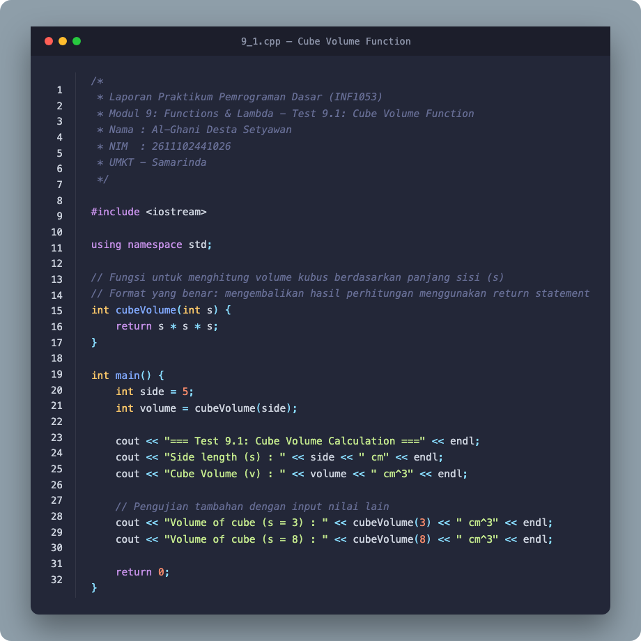 | 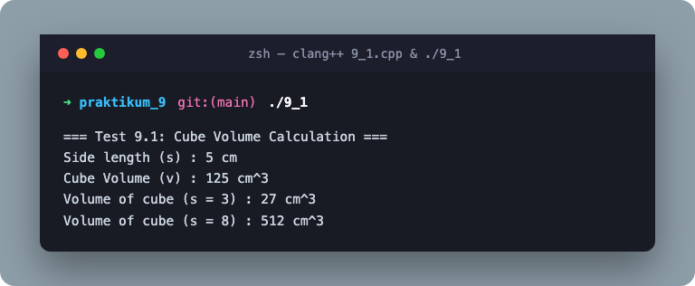 |

#### Terminal Output:
```text
=== Test 9.1: Cube Volume Calculation ===
Side length (s) : 5 cm
Cube Volume (v) : 125 cm^3
Volume of cube (s = 3) : 27 cm^3
Volume of cube (s = 8) : 512 cm^3
```

#### Penjelasan 9.1:
1. **Kesalahan awal:** Fungsi dideklarasikan dengan tipe kembalian non-void (`int cubeVolume(int s)`), tetapi di dalamnya menggunakan `cout << s * s * s;` tanpa ada pernyataan `return`. Hal ini memicu error kompilasi dan membuat nilainya tidak bisa disimpan ke dalam variabel.
2. **Perbaikan:** Mengganti baris `cout` menjadi `return s * s * s;`. Nilai volume kubus dikembalikan ke pemanggil sehingga bisa ditampung dalam variabel `int volume = cubeVolume(side);`.

---

### 2. Test 9.2: Function without Return Value

#### Instruksi:
- Buat fungsi `void` bernama `biodata` yang menampilkan nama, NIM, umur, mata kuliah, dan program studi.

#### Source Code (`9_2.cpp`):
```cpp
/*
 * Laporan Praktikum Pemrograman Dasar (INF1053)
 * Modul 9: Functions & Lambda - Test 9.2: Function without Return Value
 * Nama : Al-Ghani Desta Setyawan
 * NIM  : 2611102441026
 * UMKT - Samarinda
 */

#include <iostream>
#include <string>

using namespace std;

// Fungsi bertipe void (tanpa nilai kembalian) untuk menampilkan biodata mahasiswa
void biodata() {
    string name = "Al-Ghani Desta Setyawan";
    long long nim = 2611102441026LL;
    int age = 20;
    string course = "Pemrograman Dasar (INF1053)";
    string studyProgram = "S1 Teknik Informatika";

    cout << "========================================" << endl;
    cout << "          BIODATA MAHASISWA             " << endl;
    cout << "========================================" << endl;
    cout << "Nama          : " << name << endl;
    cout << "NIM           : " << nim << endl;
    cout << "Umur          : " << age << " tahun" << endl;
    cout << "Mata Kuliah   : " << course << endl;
    cout << "Program Studi : " << studyProgram << endl;
    cout << "========================================" << endl;
}

int main() {
    // Memanggil fungsi void biodata
    biodata();

    return 0;
}
```

#### Visualisasi Code & Output:
| Code Image | Output Terminal Image |
| :---: | :---: |
| 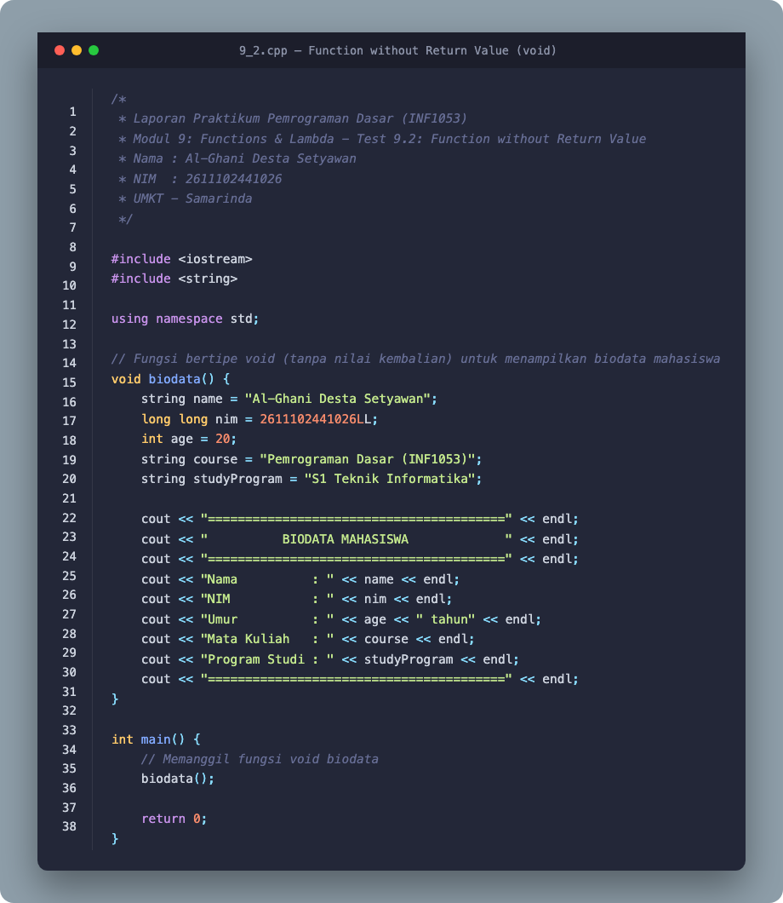 | 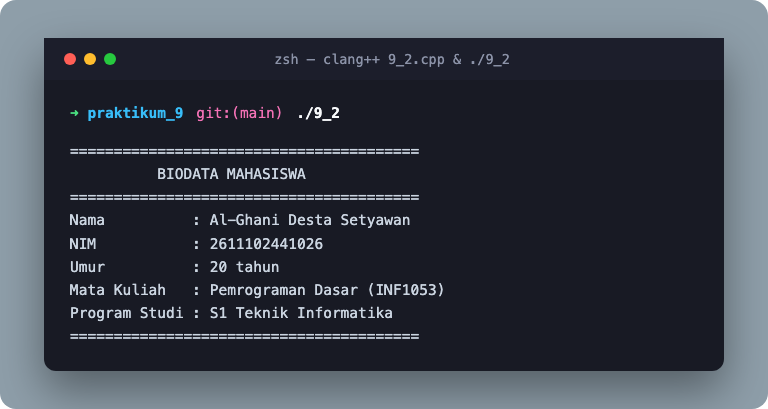 |

#### Terminal Output:
```text
========================================
          BIODATA MAHASISWA             
========================================
Nama          : Al-Ghani Desta Setyawan
NIM           : 2611102441026
Umur          : 20 tahun
Mata Kuliah   : Pemrograman Dasar (INF1053)
Program Studi : S1 Teknik Informatika
========================================
```

---

### 3. Test 9.3: Function with Default Value Parameter

#### Instruksi:
- Buat fungsi bernama `checkEven` yang menerima satu parameter integer dengan nilai default, dan mengembalikan `true` (1) jika genap dan `false` (0) jika ganjil.

#### Source Code (`9_3.cpp`):
```cpp
/*
 * Laporan Praktikum Pemrograman Dasar (INF1053)
 * Modul 9: Functions & Lambda - Test 9.3: Function with Default Value Parameter
 * Nama : Al-Ghani Desta Setyawan
 * NIM  : 2611102441026
 * UMKT - Samarinda
 */

#include <iostream>

using namespace std;

// Fungsi checkEven dengan default parameter value (n = 4)
// Mengembalikan true (1) jika genap, dan false (0) jika ganjil
bool checkEven(int n = 4) {
    return (n % 2 == 0);
}

int main() {
    cout << "=== Test 9.3: Check Even with Default Parameter ===" << endl;

    // 1. Pemanggilan tanpa argumen (menggunakan nilai default n = 4)
    cout << "Call checkEven() without argument (default n = 4):" << endl;
    cout << "Result: " << checkEven() << " (true / 1)" << endl;

    // 2. Pemanggilan dengan argumen eksplisit bilangan genap (n = 10)
    cout << "\nCall checkEven(10):" << endl;
    cout << "Result: " << checkEven(10) << " (true / 1)" << endl;

    // 3. Pemanggilan dengan argumen eksplisit bilangan ganjil (n = 7)
    cout << "\nCall checkEven(7):" << endl;
    cout << "Result: " << checkEven(7) << " (false / 0)" << endl;

    return 0;
}
```

#### Visualisasi Code & Output:
| Code Image | Output Terminal Image |
| :---: | :---: |
| 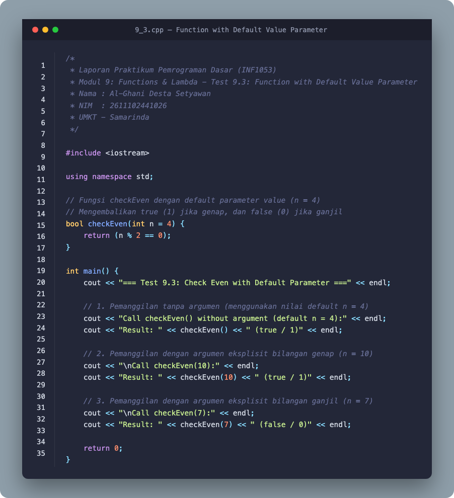 | 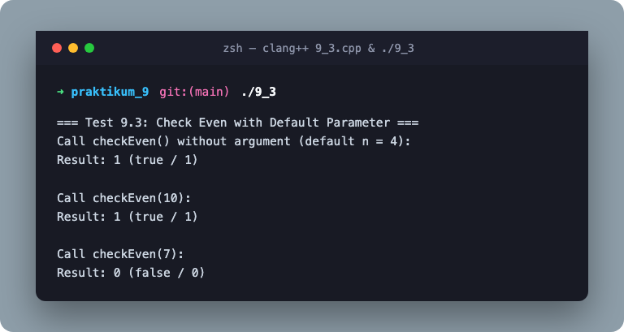 |

#### Terminal Output:
```text
=== Test 9.3: Check Even with Default Parameter ===
Call checkEven() without argument (default n = 4):
Result: 1 (true / 1)

Call checkEven(10):
Result: 1 (true / 1)

Call checkEven(7):
Result: 0 (false / 0)
```

---

### 4. Test 9.4: Prototype Function

#### Instruksi:
- Modifikasi fungsi dari Test 9.1 ke format Function Prototype.
- Jelaskan perbedaan fungsi reguler dan fungsi prototipe.

#### Source Code (`9_4.cpp`):
```cpp
/*
 * Laporan Praktikum Pemrograman Dasar (INF1053)
 * Modul 9: Functions & Lambda - Test 9.4: Prototype Function
 * Nama : Al-Ghani Desta Setyawan
 * NIM  : 2611102441026
 * UMKT - Samarinda
 */

#include <iostream>

using namespace std;

// 1. Function Prototype (Deklarasi Fungsi di atas main)
int cubeVolume(int s);

int main() {
    int side1 = 4;
    int side2 = 6;

    cout << "=== Test 9.4: Cube Volume using Prototype Function ===" << endl;
    cout << "Volume of cube (s = " << side1 << ") : " << cubeVolume(side1) << " cm^3" << endl;
    cout << "Volume of cube (s = " << side2 << ") : " << cubeVolume(side2) << " cm^3" << endl;

    return 0;
}

// 2. Function Definition (Definisi/Implementasi Fungsi di bawah main)
int cubeVolume(int s) {
    return s * s * s;
}
```

#### Visualisasi Code & Output:
| Code Image | Output Terminal Image |
| :---: | :---: |
| 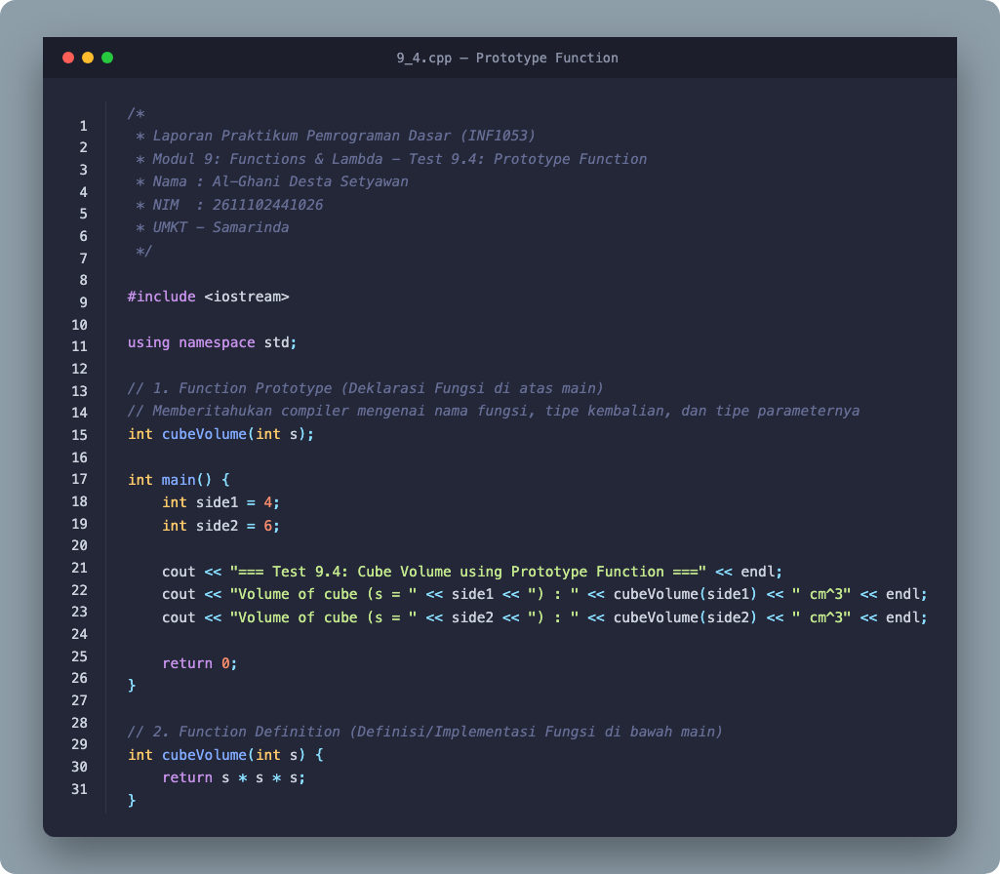 | 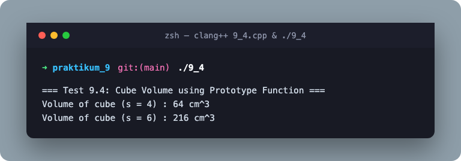 |

#### Terminal Output:
```text
=== Test 9.4: Cube Volume using Prototype Function ===
Volume of cube (s = 4) : 64 cm^3
Volume of cube (s = 6) : 216 cm^3
```

#### Penjelasan Perbedaan:
1. **Regular Function:** Seluruh kepala dan isi fungsi didefinisikan langsung di atas `main()`. Jika fungsinya banyak, baris awal program menjadi padat dan pemanggilan fungsi yang berada di bawahnya akan memicu error `undeclared identifier`.
2. **Function Prototype:** Hanya menuliskan deklarasi (*signature*) di atas `main()` diakhiri titik koma (misal: `int cubeVolume(int s);`), sementara blok kodenya diletakkan di bawah `main()`. Hal ini memberi sinyal awal ke compiler sehingga pemanggilan fungsi tetap valid di mana pun posisinya.

---

### 5. Test 9.5: Lambda Exercise I

#### Instruksi:
- Buat fungsi lambda dengan dua parameter $x$ dan $y$ yang mengembalikan hasil: $(x + y) \times 2$.
- Jelaskan cara kerja dan keluarannya.

#### Source Code (`9_5.cpp`):
```cpp
/*
 * Laporan Praktikum Pemrograman Dasar (INF1053)
 * Modul 9: Functions & Lambda - Test 9.5: Lambda Exercise I
 * Nama : Al-Ghani Desta Setyawan
 * NIM  : 2611102441026
 * UMKT - Samarinda
 */

#include <iostream>
#include <string>

using namespace std;

int main() {
    // Definisi fungsi lambda yang menerima dua parameter x dan y
    // Rumus: (x + y) * 2
    auto count = [](int x, int y) {
        return (x + y) * 2;
    };

    cout << "=== Test 9.5: Lambda Function (x + y) * 2 ===" << endl;
    cout << "count(10, 2) = " << count(10, 2) << endl;

    // Uji coba tambahan dengan variasi nilai parameter
    cout << "count(5, 3)  = " << count(5, 3) << endl;
    cout << "count(7, 8)  = " << count(7, 8) << endl;

    return 0;
}
```

#### Visualisasi Code & Output:
| Code Image | Output Terminal Image |
| :---: | :---: |
| 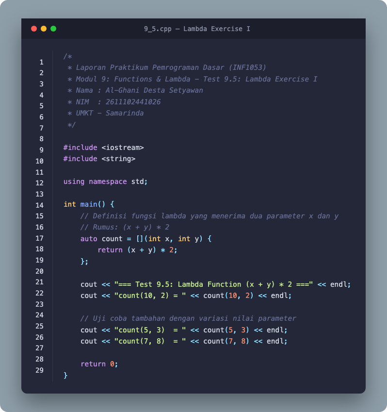 | 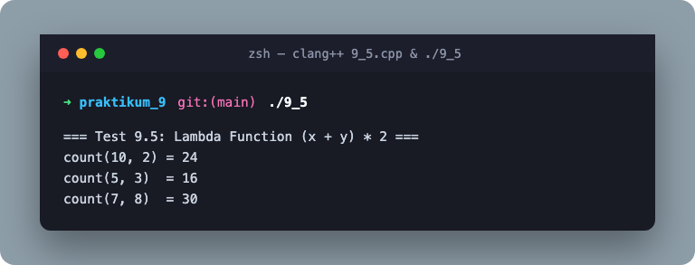 |

#### Terminal Output:
```text
=== Test 9.5: Lambda Function (x + y) * 2 ===
count(10, 2) = 24
count(5, 3)  = 16
count(7, 8)  = 30
```

#### Penjelasan 9.5:
Lambda `[](int x, int y) { return (x + y) * 2; }` disimpan dalam objek pemanggil `auto count`. Ketika `count(10, 2)` dipanggil, parameter $x=10$ dan $y=2$ dijumlahkan menjadi 12 lalu dikalikan 2 menghasilkan angka 24.

---

### 6. Test 9.6: Lambda Exercise II (Capture vs Parameter)

#### Instruksi:
- Perbaiki kode agar fungsi lambda dapat menggunakan variabel `a` dan `b` dari luar blok lambda.
- Jelaskan perbedaan antara *capture* dan *parameter* pada fungsi lambda.

#### Source Code (`9_6.cpp`):
```cpp
/*
 * Laporan Praktikum Pemrograman Dasar (INF1053)
 * Modul 9: Functions & Lambda - Test 9.6: Lambda Exercise II (Capture Clause)
 * Nama : Al-Ghani Desta Setyawan
 * NIM  : 2611102441026
 * UMKT - Samarinda
 */

#include <iostream>

using namespace std;

int main() {
    // Variabel luar (outer scope)
    int a = 10, b = 5;

    // Perbaikan: Menambahkan [a, b] pada capture clause
    auto addition = [a, b](int x, int y) {
        cout << "Capture:   " << a + b << endl;
        cout << "Parameter: " << x + y << endl;
    };

    cout << "=== Test 9.6: Lambda Capture vs Parameter ===" << endl;
    addition(10, 24);

    return 0;
}
```

#### Visualisasi Code & Output:
| Code Image | Output Terminal Image |
| :---: | :---: |
| 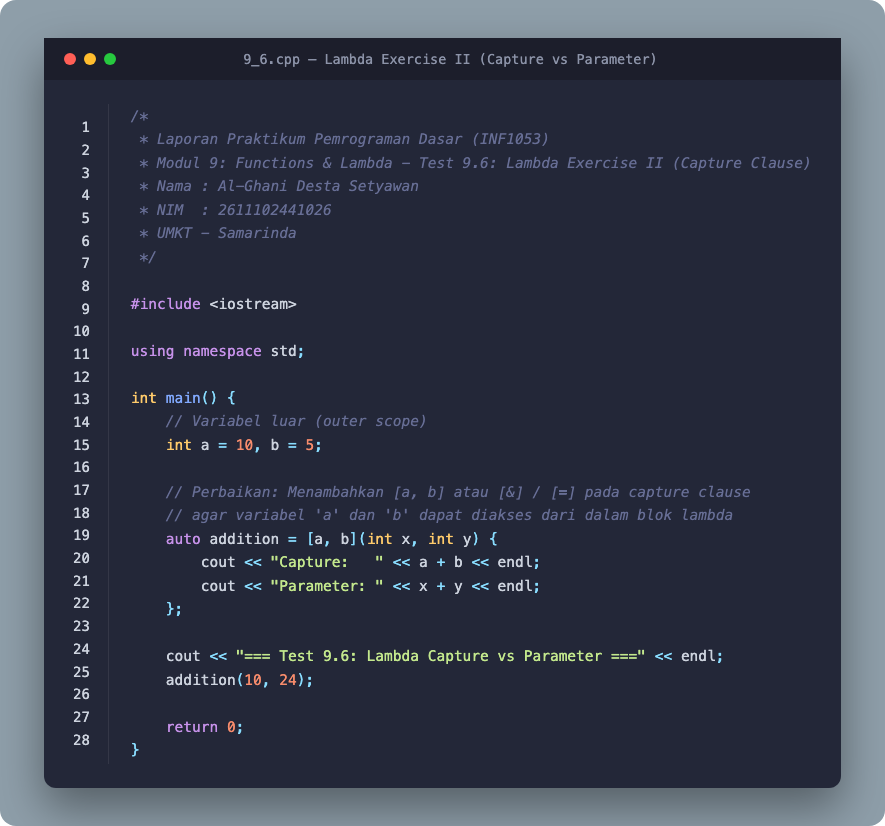 | 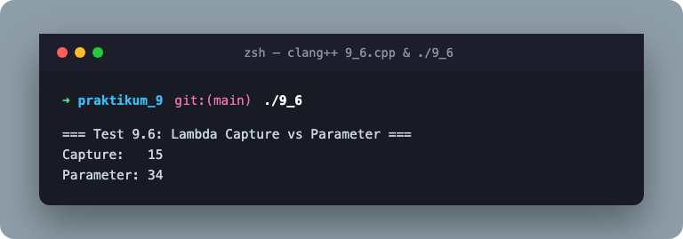 |

#### Terminal Output:
```text
=== Test 9.6: Lambda Capture vs Parameter ===
Capture:   15
Parameter: 34
```

#### Penjelasan Perbedaan:
1. **Capture Clause (`[...]`):** Berfungsi untuk "menangkap" variabel lokal dari ruang lingkup luar (*outer scope* / *enclosing scope*) agar dapat diakses di dalam blok lambda. Pada kode awal `[]` kosong sehingga variabel `a` dan `b` tidak dikenali. Diperbaiki menjadi `[a, b]`.
2. **Parameter List (`(...)`):** Merupakan variabel masukan formal yang dikirimkan saat lambda dipanggil melalui argumen (seperti `addition(10, 24)`), serupa dengan parameter fungsi standar.

---

### 7. Test 9.7: Individual Task (Recursion as Loop)

#### Instruksi:
- Buat program sederhana menggunakan studi kasus pilihan sendiri yang menerapkan fungsi rekursif untuk mendemonstrasikan perulangan (*looping*) tanpa menggunakan pernyataan *loop* (`for`/`while`).
- Jelaskan program tersebut.

#### Source Code (`9_7.cpp`):
```cpp
/*
 * Laporan Praktikum Pemrograman Dasar (INF1053)
 * Modul 9: Functions & Lambda - Test 9.7: Individual Task (Recursion as Loop)
 * Studi Kasus: Countdown dan Peluncuran Roket (Rocket Launch Countdown)
 * Nama : Al-Ghani Desta Setyawan
 * NIM  : 2611102441026
 * UMKT - Samarinda
 */

#include <iostream>

using namespace std;

// Fungsi rekursif untuk mendemonstrasikan perulangan mundur tanpa loop statement (for/while)
void countdown(int n) {
    // Base Case: Kondisi berhenti saat hitungan mencapai 0
    if (n <= 0) {
        cout << "[T-0] Liftoff! Roket berhasil diluncurkan ke luar angkasa!" << endl;
        return;
    }

    // Aksi pada setiap iterasi rekursif
    cout << "[T-" << n << "] Hitung mundur menuju peluncuran..." << endl;

    // Recursive Call: Memanggil dirinya sendiri dengan nilai n yang didekrementasikan (n - 1)
    countdown(n - 1);
}

int main() {
    int startSeconds = 5;

    cout << "========================================" << endl;
    cout << "    SIMULASI HITUNG MUNDUR ROKET        " << endl;
    cout << "     (REKURSI TANPA FOR / WHILE)        " << endl;
    cout << "========================================" << endl;

    // Memulai rekursi hitung mundur dari startSeconds
    countdown(startSeconds);

    cout << "========================================" << endl;

    return 0;
}
```

#### Visualisasi Code & Output:
| Code Image | Output Terminal Image |
| :---: | :---: |
| 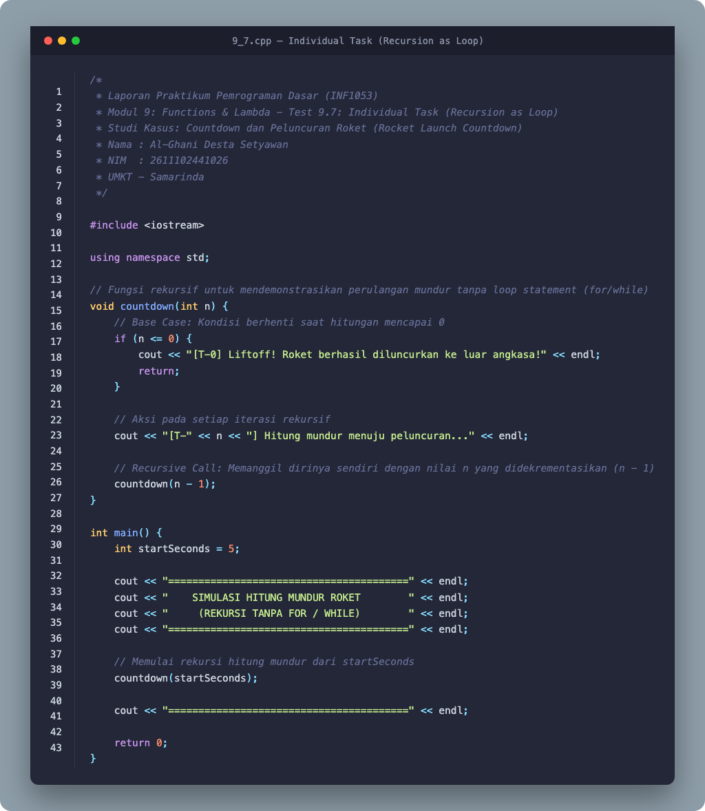 | 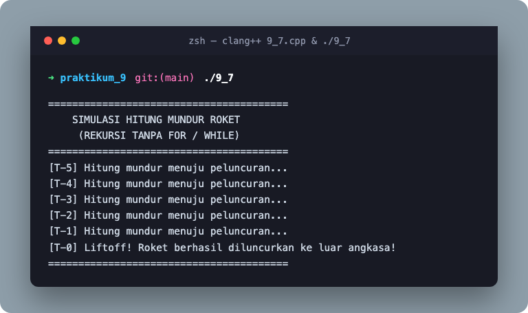 |

#### Terminal Output:
```text
========================================
    SIMULASI HITUNG MUNDUR ROKET        
     (REKURSI TANPA FOR / WHILE)        
========================================
[T-5] Hitung mundur menuju peluncuran...
[T-4] Hitung mundur menuju peluncuran...
[T-3] Hitung mundur menuju peluncuran...
[T-2] Hitung mundur menuju peluncuran...
[T-1] Hitung mundur menuju peluncuran...
[T-0] Liftoff! Roket berhasil diluncurkan ke luar angkasa!
========================================
```

#### Penjelasan Program:
1. **Studi Kasus:** Simulasi hitung mundur peluncuran roket dari detik ke-5 menuju T-0 (*Liftoff*).
2. **Looping Tanpa For/While:** Program mencetak hitungan berulang secara otomatis tanpa satupun struktur `for` atau `while`.
3. **Base Case:** Baris `if (n <= 0)` memastikan proses rekursi berhenti saat detik mencapai 0 untuk mencegah *infinite recursion* / *stack overflow*.
4. **Recursive Step:** Pemanggilan `countdown(n - 1)` secara berulang memicu eksekusi langkah berikutnya hingga *base case* tercapai.

---

## 🎓 Conclusion of Today's Lesson

> **Dari praktikum modul 9 hari ini tentang Functions & Lambda di C++, poin-poin penting yang saya pelajari dan pahami adalah:**
>
> 1. **Perbedaan Fungsi Nilai Kembalian dan Prosedur (Void):** Fungsi yang mengembalikan nilai menggunakan pernyataan `return` untuk mengirimkan hasil kalkulasi kembali ke pemanggilnya, sedangkan fungsi bertipe `void` digunakan untuk mengeksekusi instruksi prosedural tanpa mengembalikan nilai (seperti mencetak biodata).
> 2. **Nilai Bawaan Parameter (Default Parameter):** C++ memungkinkan penentuan nilai default pada parameter fungsi, sehingga fungsi tetap dapat dipanggil secara fleksibel baik dengan memberikan argumen eksplisit maupun membiarkannya kosong.
> 3. **Pentingnya Prototipe Fungsi:** Prototipe fungsi mendeklarasikan *signature* fungsi di atas `main()`, memberi tahu compiler bahwa fungsi tersebut ada sebelum definisi lengkapnya dibuat di bagian bawah. Hal ini mempermudah keterbacaan kode terstruktur.
> 4. **Kekuatan Ekspresi Lambda:** Lambda memungkinkan penulisan fungsi lokal anonim yang ringkas. Saya memahami dengan jelas peran **Capture Clause (`[...]`)** untuk mengambil variabel dari *scope* luar dan **Parameter List (`(...)`)** untuk menerima argumen saat dipanggil.
> 5. **Mekanisme Rekursi sebagai Pengganti Loop:** Melalui simulasi hitung mundur peluncuran roket, saya berhasil membuktikan bahwa perulangan dapat diimplementasikan menggunakan rekursi dengan memanfaatkan kombinasi *base case* dan *recursive call*.

